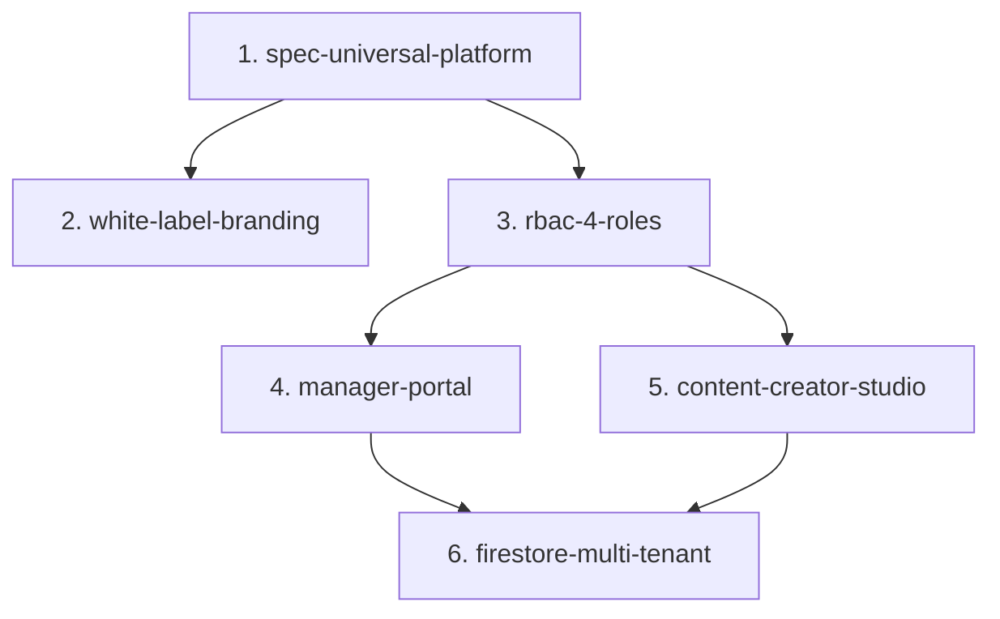

# 🗺️ CAPABILITY MAP: UNIVERSAL TRAINING PLATFORM (v3.0.0)

**Iniziativa:** Disaccoppiamento dal cliente specifico (Luxottica POC) verso **Universal Training Platform (UTP)** multi-tenant, multi-corso e multi-ruolo.

| Capability Module ID | Responsabilità | Dipende Da |
|---|---|---|
| `spec-universal-platform` | Documento di specifica formale [SPEC-universal-training-platform.md](file:///Users/maurizio.ipsale/Library/CloudStorage/GoogleDrive-maurizio.ipsale@gmail.com/My%20Drive/Progetti%20Agy/MyQwiklabs/SPEC-universal-training-platform.md) con modello a 4 ruoli, disaccoppiamento branding e schema Firestore. | — |
| `white-label-branding` | Refactoring di testi, loghi, brand di squadra e colori in `TenantConfig` dinamico basato su tenant o sessione. | `spec-universal-platform` |
| `rbac-4-roles` | Estensione di `AuthService` per supportare `STUDENT`, `TRAINER`, `MANAGER` e `CONTENT_CREATOR`. | `spec-universal-platform` |
| `manager-portal` | Modale/Pannello `#manager-admin-dialog` per la gestione dell'allowlist dinamica, importazione CSV email e report presenze. | `rbac-4-roles`, `white-label-branding` |
| `content-creator-studio` | Editor visuale di corsi, sfide SQL, tolleranze di verifica e dispense Markdown (`#content-creator-modal`). | `rbac-4-roles` |
| `firestore-multi-tenant` | Estensione di `FirestoreStateService` per le collezioni `/tenants`, `/courses`, `/allowlists` e `/sessions`. | `manager-portal`, `content-creator-studio` |

---

### Build Order Sequenziale:

