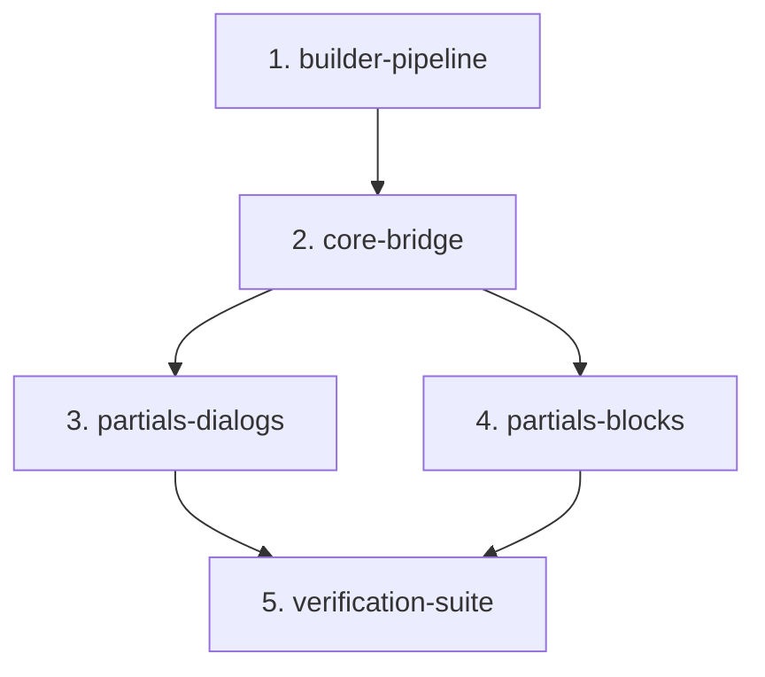

# Capability Map: Frontend Modularization & Zero-Build Pipeline

**Iniziativa:** Modularizzazione di `v2/frontend/index.html` (9.557 righe) con Zero-Build Python Assembler e Facade Bridge per Cloud Run.

| Module id | Responsibility | Depends on |
|---|---|---|
| `builder-pipeline` | Script Python deterministico (`tools/build_frontend.py`) che assembla i partials HTML, script e stili in un singolo file `v2/frontend/index.html`. Zero dipendenze Node.js. | — |
| `core-bridge` | Namespace `window.Hub` e Facade Bridge per esportare su `window` tutti i 165 handler top-level e preservare i 180+ attributi inline `onclick`/`oninput`. | `builder-pipeline` |
| `partials-dialogs` | Estrazione e scomposizione dei 12 modali nativi `<dialog>` (`rosetta-modal`, `leaderboard-modal`, `auth-modals`, ecc.) e relativa logica JS. | `core-bridge` |
| `partials-blocks` | Estrazione dei 6 blocchi didattici (`block-cover`, `block-1`..`5`) e dei 3 motori procedurali Web Audio / Canvas del Coffee Break. | `core-bridge` |
| `verification-suite` | Test suite automatizzata CDP/Playwright che valida rendering a 60fps, assenza di `ReferenceError`, funzionamento di Rosetta search e integrità d'aula. | `partials-dialogs`, `partials-blocks` |

---

### Build Order:

**Build Order Sequenziale:**
`builder-pipeline` ➔ `core-bridge` ➔ `partials-dialogs` ➔ `partials-blocks` ➔ `verification-suite`
