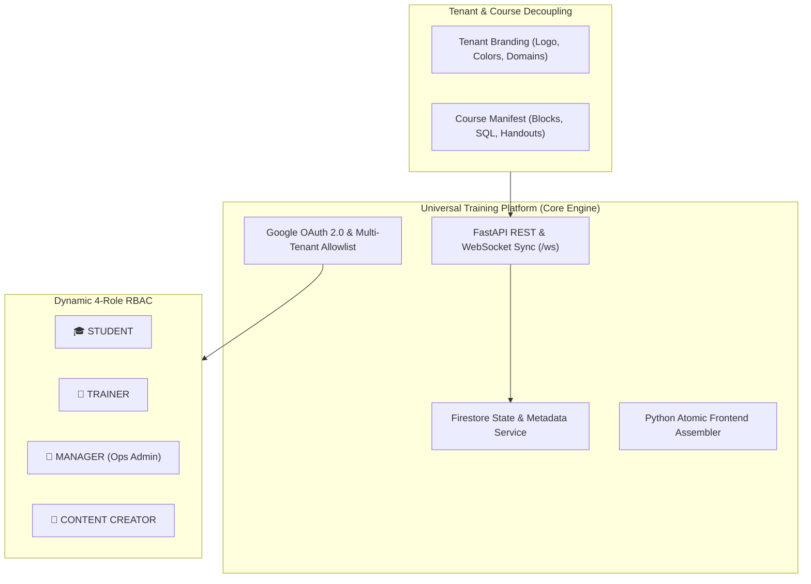
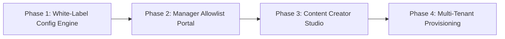

# 🚀 ARCHITECTURAL SPECIFICATION: UNIVERSAL TRAINING PLATFORM (UTP)
**Transitioning from Client-Specific POC (Luxottica) to White-Label Multi-Tenant, Multi-Course Enterprise Engine**  
**Version:** 3.0.0-draft  
**Author:** Lead Architect & Principal Software Engineer  
**Date:** October 17, 2026  

---

## 1. 🎯 Vision & Executive Summary

The **Universal Training Platform (UTP)** evolves the current Luxottica BigQuery Training Hub POC into a fully decoupled, multi-tenant, multi-course **Enterprise Classroom & Authoring Engine**. 

### Key Principles:
1. **100% White-Label & Client Agnostic**: Zero hardcoded client references (Luxottica, Oakley, Persol). Branding, logos, team brand names, themes, and domains are dynamically injected per **Tenant / Course Session**.
2. **Dynamic 4-Role RBAC Model**: Distinct experiences for `STUDENT`, `TRAINER`, `MANAGER` (Training Admin), and `CONTENT_CREATOR` (Instructional Designer).
3. **Multi-Course & Multi-Cloud Native**: Any course topic (BigQuery, Generative AI, Vertex, Terraform, Looker, Python) can be created, hosted, and delivered without code changes.
4. **Zero-Build Architecture**: Retains the zero-dependency Python assembler (`tools/build_frontend.py`), ultra-fast Gzip delivery (~105 KB), and Cloud Run serverless scalability.

---

## 2. 🏛️ Architectural Decoupling Strategy



### 2.1 Decoupling Dimensions

| Dimension | POC State (v2.2.0) | Target White-Label State (v3.0.0) |
| :--- | :--- | :--- |
| **Branding & Logos** | Hardcoded Luxottica / Google Cloud logos and text | Dynamic `TenantConfig` (Logo URL, Primary Color, Custom CSS, Organization Name) |
| **Team Gamification** | Hardcoded Luxottica Brands (*Ray-Ban, Oakley, Persol*) | Configurable Team Names per course (*Alpha, Beta* or client-custom list) |
| **Allowlist Rules** | Fixed env vars (`ALLOWED_DOMAINS`) | Dynamic Firestore Allowlist managed via **Manager Portal** (UI + CSV Upload) |
| **Course Content** | Static JSON manifest in `v2/courses/luxottica_bigquery` | Dynamic Course Store managed via **Content Creator Authoring Studio** |
| **User Roles** | Dual role (`STUDENT`, `TRAINER`) | 4-Role RBAC (`STUDENT`, `TRAINER`, `MANAGER`, `CONTENT_CREATOR`) |

---

## 3. 👥 Dynamic 4-Role RBAC Model

### 3.1 Role Capabilities & Access Control Matrix

```
+-----------------------------------------------------------------------------------+
| ROLE             | Classroom  | Regia Sync | Allowlist & CSV | Course Authoring  |
|                  | Execution  | & Lock     | Management      | & SQL Builder     |
+------------------+------------+------------+-----------------+-------------------+
| 🎓 STUDENT       |    ✅      |     ❌     |       ❌        |        ❌         |
| 👑 TRAINER       |    ✅      |     ✅     |       ❌        |        ❌         |
| 💼 MANAGER       |    ✅      |     ✅     |       ✅        |        ❌         |
| 🎨 CREATOR       |    ✅      |     ✅     |       ✅        |        ✅         |
+-----------------------------------------------------------------------------------+
```

#### 1. 🎓 `STUDENT`
- Enters session via Google OAuth or rapid check-in.
- Solves SQL & interactive challenges; earns team points & confetti.
- Enjoys gamified coffee break mini-games (DJ sequencer, optics lab, AI roast).

#### 2. 👑 `TRAINER` (Instructor)
- Full-screen Command Center (`#trainer-command-center`).
- Broadcasts active blocks, lock/unlock classroom, synchronizes timers.
- Views live student roster, progress, and solution cheat-sheets.

#### 3. 💼 `MANAGER` (Training Operations & Admin)
- **Allowlist Studio**: Add/remove permitted domains or specific emails via UI.
- **CSV Batch Import**: Drag & drop CSV of participant emails before a workshop.
- **Session Manager**: Schedule new workshop sessions and generate session codes.
- **Attendance & Analytics**: Export CSV/JSON reports of student progress, scores, and completion certificates.

#### 4. 🎨 `CONTENT_CREATOR` (Instructional Designer)
- **Visual Course Studio**: Create and edit courses without writing raw JSON/code.
- **Challenge Rule Builder**: Configure SQL validation rules (exact match, numeric tolerance, BigQuery view inspection).
- **Handout & Slide Editor**: Built-in Markdown & Mermaid diagram editor for lab handouts.
- **Pre-flight Sandbox**: One-click dry-run to test lab challenges before publishing.

---

## 4. 🗄️ Firestore Data Schema (Multi-Tenant)

### `tenants/{tenant_id}`
```json
{
  "tenant_id": "datatonic-cloud-academy",
  "org_name": "Datatonic Cloud Academy",
  "logo_url": "https://assets.example.com/logo.png",
  "primary_color": "#2563eb",
  "allowed_domains": ["datatonic.com", "google.com"],
  "team_names": ["Data Engineers", "MLOps Team", "Cloud Architects"]
}
```

### `courses/{course_id}`
```json
{
  "course_id": "gcp-bigquery-advanced",
  "title": "BigQuery & Vertex AI Masterclass",
  "description": "Enterprise Data Analytics and AI Functions lab",
  "author_email": "creator@datatonic.com",
  "blocks": [
    {
      "id": "block-1",
      "title": "Data Exploration & Studio",
      "challenges": ["b1-s1", "b1-s2"]
    }
  ]
}
```

### `allowlists/{tenant_id_or_session}`
```json
{
  "tenant_id": "datatonic-cloud-academy",
  "allowed_emails": ["student1@datatonic.com", "consultant@partner.com"],
  "allowed_domains": ["datatonic.com"],
  "updated_by": "manager@datatonic.com",
  "updated_at": "2026-10-17T17:00:00Z"
}
```

---

## 5. 🗺️ Implementation Roadmap



### **Phase 1: White-Label Config Engine (Sprint 1)**
- Extract all hardcoded Luxottica text into `i18n-translations.js` and `TenantConfig`.
- Implement dynamic branding injection (`logo_url`, `org_name`, `theme_color`).
- Refactor `/api/v2/config` to support `?tenant_id=` or `?session_id=`.

### **Phase 2: Manager Allowlist Portal (Sprint 2)**
- Build `#manager-admin-modal` UI for adding/editing allowlist emails.
- Implement CSV parser & import endpoint `POST /api/v3/admin/allowlist/import`.
- Save allowlist rules dynamically in Firestore.

### **Phase 3: Content Creator Studio (Sprint 3)**
- Build `#content-creator-modal` UI for editing course manifests.
- Implement challenge builder and Markdown handout editor.
- API endpoints `POST /api/v3/courses` and `PUT /api/v3/courses/{id}`.

### **Phase 4: Multi-Tenant Provisioning & Cloud Run Deployment (Sprint 4)**
- Terraform module update for multi-tenant Firestore collections.
- One-click deployment script for new client environments.
