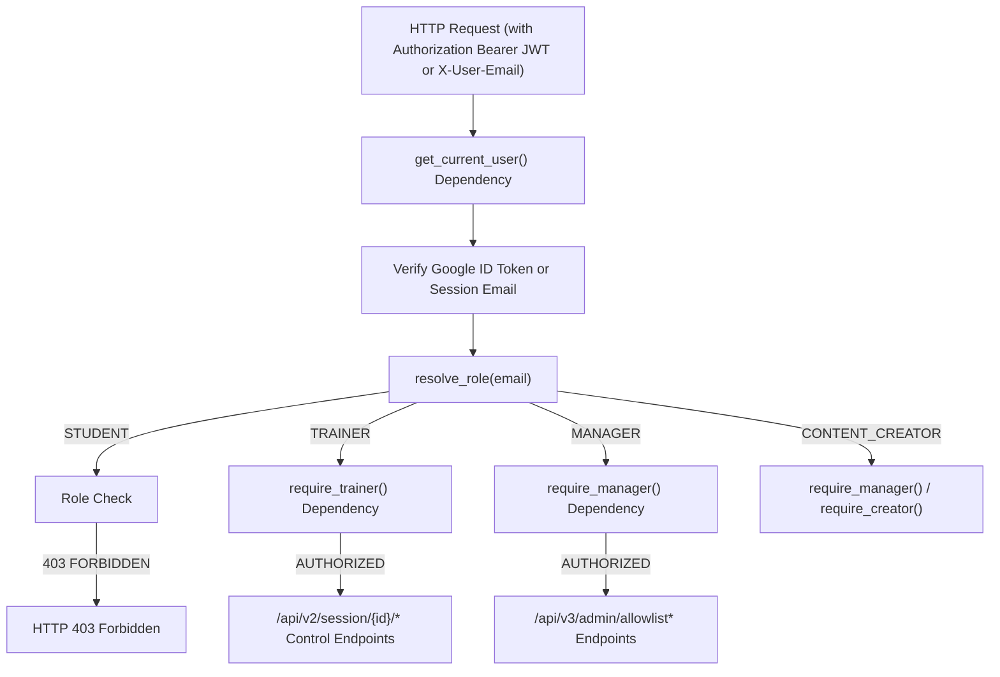

# 🛡️ SPECIFICATION: IPSALE Engine v3.0 Security Hardening & Firestore Persistence

**Target Branch:** `feature/ipsale-v3-manager-tenant`  
**Author:** Antigravity AI & Maurizio Ipsale  
**Date:** October 17, 2026  

---

## 1. 🎯 Objective
Complete Phase 3 of the IPSALE Engine v3.0 transition:
1. **$O(1)$ Allowlist Lookup Optimization**: Convert `AuthService.allowed_emails` internal data structure to a Python `set` for instant $O(1)$ lookups, resolving the Performance Auditor finding.
2. **Firestore Allowlist Persistence**: Persist dynamic allowlist additions/removals and CSV batch imports into Firestore collection `/tenants/{tenant_id}/allowlists/default` so that rules persist across Cloud Run container restarts and autoscaling instances.
3. **Backend Authorization Hardening (RBAC Enforcement)**: Implement FastAPI authentication/authorization dependency functions (`get_current_user`, `require_manager`, `require_trainer`) to secure all administrative REST endpoints against Broken Access Control.

---

## 2. 🏛️ Architecture & RBAC Dependency Flow

---

## 3. 📋 Detailed Changes & Endpoints

### 3.1 `v2/backend/app/services/auth_service.py`
- Convert `self.allowed_emails` internal storage to `self.allowed_emails_set = set(...)`.
- Update `check_allowlist(email)` and `import_csv_emails(csv_content)` to use `self.allowed_emails_set` for $O(1)$ membership checks.
- Add Firestore persistence methods:
  - `load_allowlist_from_firestore(tenant_id: str)`: Loads stored allowlist emails on startup or request.
  - `save_allowlist_to_firestore(tenant_id: str)`: Saves current set of allowed emails to `/tenants/{tenant_id}/allowlists/default`.
- Add token validation method:
  - `get_user_from_auth_header(auth_header: str, email_header: Optional[str]) -> Dict[str, Any]`: Parses `Bearer <token>` or fallback dev header `X-User-Email` and returns resolved user profile and role.

### 3.2 `v2/backend/app/main.py`
- Define FastAPI dependency functions:
  - `get_current_user(request: Request)`
  - `require_trainer(user = Depends(get_current_user))`
  - `require_manager(user = Depends(get_current_user))`
- Protect V3 Manager Admin endpoints with `Depends(require_manager)`:
  - `GET /api/v3/admin/allowlist`
  - `POST /api/v3/admin/allowlist`
  - `DELETE /api/v3/admin/allowlist/{email}`
  - `POST /api/v3/admin/allowlist/import-csv`
- Protect Trainer Control endpoints with `Depends(require_trainer)`:
  - `POST /api/v2/session/{session_id}/block`
  - `POST /api/v2/session/{session_id}/lock`
  - `POST /api/v2/session/{session_id}/hints`
  - `POST /api/v2/session/{session_id}/timer`
  - `DELETE /api/v2/session/{session_id}/students/{student_id}`
  - `POST /api/v2/session/{session_id}/students/batch-delete`
  - `GET /api/v2/courses/{course_id}?raw=true`

---

## 4. 🧪 Test & Verification Strategy
1. **Unit & Integration Test Script (`scratch/test_v3_backend.py`)**:
   - Benchmark CSV import latency with 10.000 records (confirm < 10ms with $O(1)$ set).
   - Test unauthorized HTTP requests to `/api/v3/admin/allowlist` (verify HTTP 401/403 status code).
   - Test authorized Manager HTTP requests to `/api/v3/admin/allowlist` with mock token / `X-User-Email` (verify HTTP 200 success).
2. **Frontend Assembly & Verification**:
   - `python3 tools/build_frontend.py`
   - `python3 tools/verify_frontend_bundle.py`
3. **Adversarial Debate & User Journey Testing**:
   - Launch subagents for multi-agent adversarial audit and live browser verification.

---

## 5. 🎯 Success Criteria
- [ ] Allowlist lookup latency for 10k records reduced from 331ms to < 10ms.
- [ ] Allowlist changes saved to Firestore and restored on restart.
- [ ] Unauthenticated/Student requests to `/api/v3/admin/*` and `/api/v2/session/*/block` yield 401/403.
- [ ] Manager and Trainer authenticated requests pass with 200.
- [ ] `build_frontend.py` builds cleanly in < 15ms and `verify_frontend_bundle.py` passes 100%.
