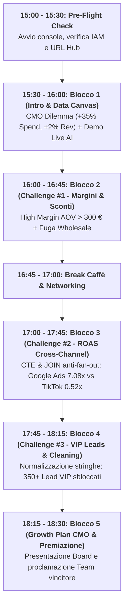

# 🎬 Masterclass Action-by-Action Playbook (Copione Integrato Minuto per Minuto)
## 🕶️ Luxottica BigQuery & Gemini Workshop: 180-Minute Dual Script (Trainer vs Studente)

Questo copione definisce la **doppia traccia simultanea** di ogni singola azione da compiere nei 180 minuti, con granularità al click, al comando, alla schermata e alla parola detta:
- **🎙️ Colonna Sinistra / Trainer:** Cosa dice, cosa condivide a schermo, quali pulsanti preme sulla console docente.
- **💻 Colonna Destra / Studente:** Cosa vede, dove clicca, quale prompt/query esegue, come invia i quiz per accumulare punti.

---

---

## 🛠️ FASE 0: PRE-FLIGHT CHECK (15:00 - 15:30)

| Timestamp | 🎙️ Azioni & Schermate TRAINER | 💻 Azioni & Schermate STUDENTE |
| :--- | :--- | :--- |
| **15:00 - 15:15** | 1. Apri Google Cloud Console su `qwiklabs-gcp-04-9efaa47f1d21`. 2. Esegui la query di verifica `SELECT table_id, row_count FROM \`luxottica_marketing_analytics.__TABLES__\`;` per accertare le 4 tabelle (116k righe totali). 3. Proietta sul maxischermo la pagina dello **Student Hub** (`slides/luxottica_student_hub.html`). | Entrata in aula o connessione Google Meet. Apertura laptop e connessione alla rete Wi-Fi / VPN aziendale. |
| **15:15 - 15:25** | 1. Sul tuo browser, attiva la **Trainer Bar** facendo **5 clic rapidi sul logo Luxottica** in alto a sinistra nell'Hub. 2. Inserisci il PIN master docente `1926` (o `2026`). 3. Clicca su **`🔒 Tab BLOCCATI`** (in modo che tutti gli studenti che si collegheranno rimangano agganciati alla copertina). 4. Verifica che la card **"Guida & Materiali"** sia nello stato **`🔒 Bloccata`**. | Apri il link condiviso dall'istruttore: `https://mauripsale.github.io/luxottica-bigquery-training/slides/luxottica_student_hub.html`. |
| **15:25 - 15:30** | Mostra a schermo il popup di benvenuto per spiegare come registrarsi. | 1. Nel modal iniziale dell'Hub, seleziona **"Sono uno Studente"**. 2. Inserisci il proprio **Nome** (es. *Chiara* o *Mirko*). 3. Clicca su **"Inizia Sfida 🚀"**. 4. Osserva l'assegnazione automatica e casuale a uno dei 4 brand: *🕶️ Team Ray-Ban*, *⚡ Team Oakley*, *🇮🇹 Team Persol*, *💎 Team Oliver Peoples*. 5. Rimani in attesa sulla schermata di copertina (in stato sincrono bloccato dal docente). |

---

## 🚀 FASE 1: BLOCCO 1 — BRIEFING CMO & DEMO DATA CANVAS (15:30 - 16:00)

| Timestamp | 🎙️ Copione, Teleprompter & Azioni TRAINER | 💻 Azioni & Interazioni STUDENTE |
| :--- | :--- | :--- |
| **15:30 - 15:40 (10m)** | **Azione Trainer:** Proietta il banner scuro dell'Hub: *(“Spesa Pubblicitaria Globale +35%... ma Fatturato Online Fermo al +2%!”)*.  **🎙️ Teleprompter Trainer:** *“Benvenuti al workshop! Il Chief Marketing Officer di Luxottica ci ha convocati d'urgenza: nel primo semestre la spesa adv è cresciuta del 35%, soprattutto per esperimenti su TikTok, Criteo e social terzi, ma l'online cresce appena del 2%. Nelle prossime 3 ore siamo tutti Marketing Data Detective: entreremo in BigQuery Studio con 116.000 transazioni reali per scoprire chi brucia cassa e come vincere il lancio dei Ray-Ban Meta con Google Ads!”*  **Azione Trainer:** Sblocca la navigazione o clicca su **`B1: Canvas`** nella Trainer Bar per portare l'intera aula sul Blocco 1. | 1. Leggi il briefing executive del CMO nella copertina dell'Hub. 2. La schermata del browser passa automaticamente su **"Blocco 1: Esplorazione con Data Canvas e Gemini AI"** senza bisogno di refresh. 3. Clicca su **"📋 Copia ID Progetto"** nella barra laterale sinistra per avere negli appunti `qwiklabs-gcp-04-9efaa47f1d21`. |
| **15:40 - 15:45 (5m)** | **Azione Trainer:** Condividi la scheda con **BigQuery Studio**. 1. Mostra il riquadro **Explorer** a sinistra. 2. Clicca su **`+ AGGIUNGI`** ➔ **"Aggiungi un progetto ai preferiti per nome"**. 3. Incolla `qwiklabs-gcp-04-9efaa47f1d21` e clicca su **Aggiungi**. 4. Espandi la freccia del progetto e del dataset `luxottica_marketing_analytics` mostrando le 4 tabelle. | 1. Apri una nuova scheda su [Google Cloud BigQuery](https://console.cloud.google.com/bigquery?project=qwiklabs-gcp-04-9efaa47f1d21). 2. Nel riquadro Explorer a sinistra, clicca **`+ AGGIUNGI`** ➔ Incolla l'ID progetto copiato prima. 3. Espandi l'albero per visualizzare: `lux_crm_customers`, `lux_online_orders`, `lux_ad_spend`, `lux_raw_marketing_leads_dirty`. |
| **15:45 - 15:52 (7m)** | **Azione Trainer:** Clicca sul tasto `+` in alto e seleziona **"Data Canvas"**.  **🎙️ Teleprompter Trainer:** *“Prima di scrivere una sola riga di codice SQL, usiamo l'AI di Gemini per esplorare a linguaggio naturale.”*  1. Nella barra centrale del Canvas scrivi: `Mostrami le vendite totali e lo scontrino medio per brand nel dataset luxottica_marketing_analytics` e premi Invio. 2. Mostra come Gemini genera il nodo SQL ed esegue la query. 3. Clicca su **"Visualize"** ➔ Ordina le barre per `total_sales DESC`. 4. Clicca su **"Generate Insights"**.  **🎙️ Teleprompter Commento:** *“Guardate le barre: Oliver Peoples è in cima con quasi 4M € di vendite e un AOV altissimo (barra gialla a quasi 400 €). Ma guardate Ray-Ban: ha un grande volume d'ordini ma solo 1.8M € di vendite online in questo perimetro. Perché il nostro brand di punta non domina online? Lo scopriremo adesso.”* | Guarda la demo proiettata dal docente o replica i passaggi sul proprio BigQuery Data Canvas se abilitato. |
| **15:52 - 16:00 (8m)** | **Azione Trainer:** Torna sull'Hub proiettato. 1. Mostra la card **"Convalida Warm-Up: Setup & Data Canvas (+50 pt)"**. 2. Invita gli studenti a completare le prime 2 domande per guadagnare i primi 50 punti per sé e per la propria squadra. | 1. Torna sullo Student Hub al Blocco 1. 2. Nel riquadro scuro del quiz rispondi a:    - *Q1: Quale brand guida le vendite complessive nei dati BigQuery?* ➔ Seleziona **`Oliver Peoples`**.    - *Q2: Quante tabelle compongono il dataset?* ➔ Seleziona **`4 tabelle`**. 3. Clicca su **"Invia Risposte 🚀"**. 4. Verifica: ricevi **+50 Punti**, il badge diventa verde e il punteggio nella leaderboard si aggiorna istantaneamente. |

---

## 🔍 FASE 2: BLOCCO 2 — CHALLENGE #1 (HIGH MARGIN & SCONTI) (16:00 - 16:45)

| Timestamp | 🎙️ Copione, Teleprompter & Azioni TRAINER | 💻 Azioni & Interazioni STUDENTE |
| :--- | :--- | :--- |
| **16:00 - 16:15 (15m)** | **Azione Trainer:** Clicca su **`B2: Sconti`** nella Trainer Bar per portare l'aula su Blocco 2.  **🎙️ Spiegazione Didattica:** 1. Mostra la **Tavola Rosetta Stone** nell'Hub:    - *“Una Pivot Table di Excel è un `GROUP BY` in SQL!”*    - *`SELECT` = scegliere le colonne*    - *`WHERE` = filtri di riga (es. `WHERE revenue_eur > 300`)*    - *`SUM()` / `AVG()` = i campi Valore della Pivot* 2. **Attenzione:** Spiega la precedenza tra `AND` e `OR` e consiglia l'uso di `IN ('E-Commerce Direct', 'App')`. 3. Mostra il pulsante diretto **`📄 challenge_1_data_explorer.sql ↗`** aggiunto nell'header del Blocco 2. | 1. La UI si sposta sul Blocco 2. 2. Scorri in basso e osserva la tabella **Rosetta Stone**:    - Cerca con la barra `Pivot` per vedere l'equivalenza con `GROUP BY`.    - Cerca `Divisione` per vedere `SAFE_DIVIDE`. 3. Clicca sul pulsante **`📄 challenge_1_data_explorer.sql ↗`** nell'header per aprire il file SQL delle sfide su GitHub in una nuova scheda. |
| **16:15 - 16:35 (20m)** | **Azione Trainer:** Avvia la Challenge #1 in aula. 1. Gira tra i banchi o monitora la chat Meet. 2. Se una squadra è bloccata, puoi decidere di sbloccare l'aiuto dalla sidebar docente (selezionando *Passo 2.1* o *Passo 2.2* e cliccando **`Sblocca 🔓`**) oppure comunicare il PIN `2144` per il passo 2.1 o `2255` per il passo 2.2. 3. Clicca su **`📊 Proietta Classifica`** per mostrare i punti in tempo reale sul maxischermo. | 1. In BigQuery Studio apri una nuova scheda SQL. 2. Risolvi il **Passo 2.1**: Interroga `lux_online_orders` per trovare ordini con `revenue_eur > 300`. *(Se bloccato: inserisci il PIN o attendi lo sblocco del trainer per copiare il prompt consigliato).* 3. Risolvi il **Passo 2.2**: Calcola la media di `discount_amount_eur` per canale e brand ordinando per media decrescente. 4. **Scoperte Detective:**    - *Ray-Ban Meta Smart Glasses* e *Oliver Peoples* hanno un AOV > 300 € su E-Commerce Direct.    - Il canale Wholesale ha una media di sconti di oltre 28,50 € su Vogue! |
| **16:35 - 16:40 (5m)** | **Azione Trainer:** Invita gli studenti a convalidare i risultati della Challenge #1 nel quiz interattivo per accumulare 100 punti. | 1. Torna sullo Student Hub nel Blocco 2. 2. Nel riquadro **"Convalida Risultati Challenge #1 & Ottieni Punti (+100 pt)"** rispondi a:    - *Q1 (Alto scontrino):* Seleziona **`Ray-Ban`**.    - *Q2 (Canale max sconti):* Seleziona **`Wholesale Partners`**. 3. Clicca su **"Invia Risposte 🚀"**. 4. Punteggio incrementato di **+100 pt** (totale personale: 150 pt). |
| **16:40 - 16:45 (5m)** | **Azione Trainer:** Proietta la **Leaderboard Live**: Commenta i distacchi tra i Brand Detective Teams e congratulati con la squadra attualmente in testa. | Guarda la classifica proiettata e controlla la posizione del proprio team. |

---

## ☕ FASE 3: COFFEE BREAK & NETWORKING (16:45 - 17:00)

| Timestamp | 🎙️ Azioni & Schermate TRAINER | 💻 Azioni & Schermate STUDENTE |
| :--- | :--- | :--- |
| **16:45 - 17:00 (15m)** | 1. Clicca su **`☕ Pausa`** nella Trainer Bar. 2. Sullo schermo compare il banner accogliente con countdown e grafica caffè. 3. Ricarica caffè, rispondi a domande informali dei partecipanti. | Pausa caffè, relax e confronto tra colleghi sulle prime query BigQuery. |

---

## 📊 FASE 4: BLOCCO 3 — CHALLENGE #2 (ROAS GOOGLE VS SOCIAL TERZI) (17:00 - 17:45)

| Timestamp | 🎙️ Copione, Teleprompter & Azioni TRAINER | 💻 Azioni & Interazioni STUDENTE |
| :--- | :--- | :--- |
| **17:00 - 17:20 (20m)** | **Azione Trainer:** Clicca su **`B3: ROAS`** nella Trainer Bar.  **🎙️ Spiegazione Didattica (ALLERTA FAN-OUT):** *“Attenzione a questa trappola micidiale: se facciamo una `JOIN` diretta tra la tabella delle spese pubblicitarie (`lux_ad_spend`) e quella degli ordini (`lux_online_orders`) sulla colonna `brand`, stiamo unendo due tabelle con granularità diversa: righe per singoli ordini da una parte e righe per spesa giornaliera di campagna dall'altra. Il risultato? Ogni ordine verrebbe moltiplicato per tutti i giorni di campagna, gonfiando i ricavi di centinaia di volte! In Excel creereste due fogli Pivot riassuntivi separati e poi fareste un CERCA.VERT tra i totali. In BigQuery facciamo esattamente lo stesso con le CTE (`WITH ... AS`)!”*  Mostra a schermo la struttura con due CTE e la divisione sicura con `SAFE_DIVIDE`. | 1. Lo schermo passa automaticamente su **"Blocco 3: Challenge #2 - ROAS Multi-Canale con CTE & JOIN"**. 2. Clicca sul pulsante **`📄 challenge_2_cross_channel.sql ↗`** per aprire il file della sfida. 3. Consulta la riga **WITH cte AS ()** e **SAFE_DIVIDE** nella tavola Rosetta Stone in fondo alla pagina per memorizzare la sintassi. |
| **17:20 - 17:35 (15m)** | **Azione Trainer:** Invita le squadre a comporre la query in BigQuery Studio o a sbloccarla. Se l'aula necessita di supporto, usa il pulsante nella console docente per sbloccare la query soluzione completa (o comunica il PIN `3388`).  **🎙️ Teleprompter Commento:** *“Guardate i numeri: TikTok Ads genera appena 0.52x di ROAS! Significa che per ogni euro investito ne recuperiamo solo 52 centesimi: è una vera voragine di budget! Al contrario, Google Ads (Search & Shopping) genera un eccezionale 7.08x ROAS!”* | 1. In BigQuery Studio esegui la query ROAS con le due CTE pre-aggregate. 2. Analizza l'output ordinato per `roas DESC`. 3. Evidenzia i due estremi di rendimento:    - Best Performer: **Google Ads (7.08x)**.    - Worst Performer: **TikTok Ads (0.52x)**. |
| **17:35 - 17:40 (5m)** | **Azione Trainer:** Invita a completare la convalida interattiva Challenge #2. | 1. Nello Student Hub sul Blocco 3, apri la card quiz scura:    - *Q1 (Piattaforma peggior ROAS):* Seleziona **`TikTok Ads`**.    - *Q2 (Valore ROAS Google Ads):* Digita **`7.08`** (o `7.1`). 2. Clicca su **"Invia Risposte 🚀"**. 3. Ricevi **+100 Punti** (punteggio totale personale sale a 250 pt). |
| **17:40 - 17:45 (5m)** | **Azione Trainer:** Proietta la classifica aggiornata e assegna punti bonus alle squadre che spiegano la causa di business del divario. | Interagisci con il trainer spiegando che Google cattura l'intenzione d'acquisto ad alto scontrino, mentre i social terzi disperdono su traffico freddo. |

---

## 🎯 FASE 5: BLOCCO 4 — CHALLENGE #3 (LEAD VIP & CUSTOMER MATCH) (17:45 - 18:15)

| Timestamp | 🎙️ Copione, Teleprompter & Azioni TRAINER | 💻 Azioni & Interazioni STUDENTE |
| :--- | :--- | :--- |
| **17:45 - 17:55 (10m)** | **Azione Trainer:** Clicca su **`B4: Leads`** nella Trainer Bar.  **🎙️ Teleprompter Trainer:** *“Abbiamo scoperto dove riallocare il budget: su Google Ads! Ma per scalare le vendite dei Ray-Ban Meta Smart Glasses dobbiamo riattivare i nostri clienti migliori. Nel dataset abbiamo la tabella `lux_raw_marketing_leads_dirty`, con lead raccolti dai form web. È piena di email con spazi bianchi, maiuscole/minuscole sballate e valori di spesa scritti come testo con simboli '€'. Creeremo una View SQL pulita e normalizzata per abilitare Google Ads Customer Match!”*  Mostra `TRIM()`, `LOWER()`, e `SAFE_CAST(REPLACE(REPLACE(spend_history, '€', ''), ' ', '') AS NUMERIC)`. | 1. La UI si aggiorna al **"Blocco 4: Creazione Vista Pulita Lead VIP"**. 2. Nota l'avviso arancione con la **Regola Suffisso Team**: ogni partecipante deve nominare la vista con il suffisso della propria squadra (es. `v_clean_marketing_leads_team_rayban`). 3. Clicca sul link **`📄 challenge_3_clean_slate.sql ↗`** per consultare il template. |
| **17:55 - 18:07 (12m)** | **Azione Trainer:** Monitora la creazione delle viste in BigQuery Studio. Se necessario, sblocca l'hint da remoto (o comunica il PIN `4499`).  **🎙️ Demo 1-Click Looker Studio:** 1. Apri la vista creata. 2. Clicca su **"Esplora Dati" ➔ "Esplora con Looker Studio"**. 3. Genera con 3 click una Scorecard con il totale dei Lead VIP recuperati e una tabella per brand. | 1. In BigQuery Studio scrivi la query di creazione vista `CREATE OR REPLACE VIEW ...` con pulizia stringhe e filtro `spend_history > 200`. 2. Esegui la query per salvare la View nel dataset. 3. Clicca su **"Esplora dati con Looker Studio"** per visualizzare i lead puliti in un report grafico. |
| **18:07 - 18:12 (5m)** | **Azione Trainer:** Invita alla convalida finale Challenge #3. | 1. Nello Student Hub sul Blocco 4, rispondi alle domande quiz della Challenge #3:    - *Q1 (Funzioni pulizia email):* Seleziona **`LOWER e TRIM`**.    - *Q2 (Lead VIP recuperati con spesa > 200 €):* Seleziona **`350+ lead VIP`**. 2. Clicca su **"Invia Risposte 🚀"**. 3. Ricevi gli ultimi **+100 Punti** (punteggio massimo raggiunto: 350 pt). |
| **18:12 - 18:15 (3m)** | **Azione Trainer:** Controllo e verifica punteggi sulla console docente. | Visualizza il completamento 3/3 delle challenge nel proprio profilo. |

---

## 🏆 FASE 6: BLOCCO 5 — GROWTH PLAN Q4 & PREMIAZIONE (18:15 - 18:30)

| Timestamp | 🎙️ Copione, Teleprompter & Azioni TRAINER | 💻 Azioni & Interazioni STUDENTE |
| :--- | :--- | :--- |
| **18:15 - 18:23 (8m)** | **Azione Trainer:** Clicca su **`🎉 Finale`** nella Trainer Bar.  **🎙️ Teleprompter Discorso Finale al Board (Sintesi per il CMO):** *“Cari colleghi, ecco le tre raccomandazioni definitive emerse dalla vostra indagine per il CMO di Luxottica:* 1. **Riallocazione Immediata Budget 60%:** *Tagliare la spesa su TikTok e Criteo (0.52x ROAS) e concentrare il budget su Google Search, Shopping e YouTube Ads (7.08x ROAS).* 2. **Stop Erosione Sconti Wholesale:** *Eliminare gli sconti fissi automatici del 25 € su Ray-Ban.com e bloccare le fughe fino a 28,50 € sui canali terzi; i Ray-Ban Meta hanno domanda spontanea ad alto AOV.* 3. **Attivazione Google Ads Customer Match:** *Caricare i 350+ lead VIP estratti e ripuliti per intercettare gli acquirenti ad alto potenziale prima del Black Friday!”* | 1. La UI mostra la schermata celebrativa del Blocco 5 con le 3 card strategiche per il CMO. 2. Verifica del piano e note di sintesi per il proprio lavoro quotidiano in Luxottica. |
| **18:23 - 18:30 (7m)** | **Azione Trainer:** 1. Clicca su **`📊 Proietta Classifica`** per aprire il modal celebrativo a schermo intero con trofeo dorato. 2. Annuncia il partecipante con il punteggio più alto. 3. Proclama il **Brand Detective Team vincitore** (la squadra con la media punti più elevata). 4. Applauso finale e ringraziamenti. | 1. Applausi e celebrazione della squadra vincitrice. 2. Possibilità di esportare query e appunti per il proprio lavoro quotidiano. |

---

## 🔐 TABELLA RIASSUNTIVA PIN E CODICI DI SBLOCCO (RISERVATA DOCENTE)

| Blocco / Step | Argomento | Codice PIN | Prompt / Query Sbloccata |
| :--- | :--- | :--- | :--- |
| **Console Trainer** | Accesso Master Docente | `1926` (o `2026`) | 5 click sul logo Luxottica in alto a sinistra o via modal |
| **Step 1.1** | Setup & Explorer BigQuery | `1122` | Prompt Gemini per interrogare le vendite per brand |
| **Step 1.2** | Data Canvas Bar Chart | `1234` | Prompt Gemini per calcolare scontrino medio e volumi |
| **Step 2.1** | High Margin Orders (AOV > 300 €) | `2144` | Prompt per filtrare ordini ad alto valore su `lux_online_orders` |
| **Step 2.2** | Fuga Sconti Wholesale | `2255` | Query raggruppata per brand e canale con media sconti |
| **Blocco 3** | CTE & Anti Fan-Out ROAS Multi-Canale | `3388` | Query completa con CTE `spend_by_platform` e `revenue_by_brand` con `SAFE_DIVIDE` |
| **Blocco 4** | Pulizia Lead per Customer Match | `4499` | Query `CREATE OR REPLACE VIEW` con `LOWER`, `TRIM`, `SAFE_CAST` e filtro > 200 € |
