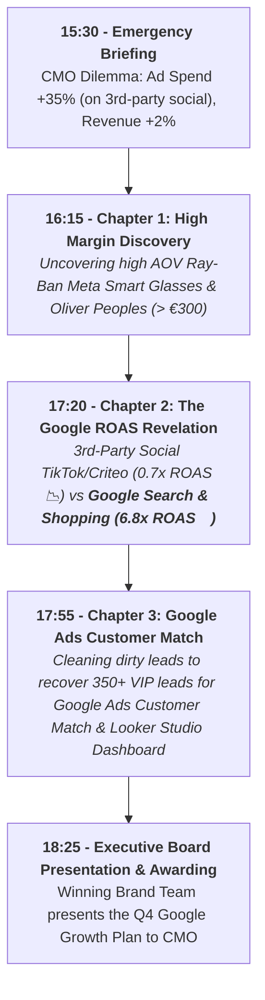

# 🕶️ Luxottica BigQuery Training: Instructor Master Guide
## The Definitive 180-Minute Facilitation Script & Live Teleprompter (Google Ecosystem Edition)

**Course Title:** BigQuery for Data Analysis: Mastering Marketing Data with BigQuery SQL  
**Story Narrative:** "Unlocking High-ROAS Google Ads Growth & Capturing Ray-Ban Meta Search Demand"  
**GCP Project Name:** `bigquery-luxottica`  
**GCP Project ID:** `qwiklabs-gcp-04-9efaa47f1d21`  
**Project Owner:** `student-02-25b97e18011e@qwiklabs.net` (student b50b8eff)  
**Target Dataset:** `qwiklabs-gcp-04-9efaa47f1d21.luxottica_marketing_analytics`  
**Target Audience:** Global Analytics, Business Analyst, Digital Commerce & Retail Operations  
**Date & Time:** Oct 12th, 2026 | 15:30 - 18:30 (3 Hours / 180 Minutes)  
**Format:** Hybrid (In-Person & Remote Connection)

---

## 📋 1. Trainer Pre-Flight & Setup Checklist (Before 15:30)

### 1.1 GCP Environment & IAM Setup
1. **Target Project:** `qwiklabs-gcp-04-9efaa47f1d21` (`bigquery-luxottica`).
2. **Dataset Pre-loading:** Execute `dataset/00_setup_schema_and_data.sql` **BEFORE** the session starts.
3. **Verify Table Creation (116,000+ Total Rows):**
   - `lux_crm_customers` (10,000 Rows)
   - `lux_online_orders` (100,000 Rows)
   - `lux_ad_spend` (5,000 Rows)
   - `lux_raw_marketing_leads_dirty` (1,000 Rows)
4. **IAM Roles Assigned to Participants:**
   - `BigQuery Job User` (`roles/bigquery.jobUser`) on project `qwiklabs-gcp-04-9efaa47f1d21`.
   - `BigQuery Data Viewer` (`roles/bigquery.dataViewer`) on dataset `luxottica_marketing_analytics`.

### 1.2 Materials & File Sharing Strategy
1. **Participant Handouts Folder (Drive / Intranet):**
   - [student_guide.md](file:///Users/maurizio.ipsale/Code/my-agy-projects/projectA/student_guide.md) (Student Quick Start & Rosetta Stone Cheat Sheet)
   - [00_data_storytelling_narrative.md](file:///Users/maurizio.ipsale/Code/my-agy-projects/projectA/handouts/00_data_storytelling_narrative.md) (Step-by-Step Analytical Script)
   - [04_action_by_action_playbook.md](file:///Users/maurizio.ipsale/Code/my-agy-projects/projectA/handouts/04_action_by_action_playbook.md) (Minute-by-Minute Dual Action Playbook: Trainer vs Student)
   - Exercise SQL files: `challenges/challenge_1_data_explorer.sql`, `challenges/challenge_2_cross_channel.sql`, `challenges/challenge_3_clean_slate.sql`.
2. **Console Pinning Instructions:** Show participants how to click **"+ ADD" -> "Star a project by name"** and type `qwiklabs-gcp-04-9efaa47f1d21`.

---

## 🎬 2. The Google Ecosystem Storytelling Narrative

> **The Executive Problem (15:30 Briefing):**  
> *"Global digital ad spend increased by +35% (driven by heavy experimental spend on third-party social networks), but overall online revenue growth stayed flat at +2%. The CMO needs a Q4 Growth Plan! Your teams of Marketing Data Detectives have 3 hours in BigQuery Studio to solve the mystery, identify budget waste on third-party networks, prove the massive ROAS of Google Ads (Search, Shopping, YouTube), and present the Q4 Growth Plan!"*

---

## 🏆 3. Gamification Rules & Brand Detective Teams

- **4 Brand Teams:** Team Ray-Ban, Team Oakley, Team Persol, Team Oliver Peoples.
- **Points System:**
  - First team with correct SQL query: **+100 Points**
  - Best business insight/story interpretation: **+50 Points**
  - Most creative Looker Studio Executive Dashboard: **+100 Points**

---

## ⏱️ 4. Master Schedule & Live Teleprompter Script (Guided Blocks)

### 🎓 Trainer Control Console & Progressive Hint Unlocking
To control participant pacing and prevent spoilers in the **Student Hub UI**, the instructor has access to the left-side **Trainer Command Console** (unlocked exclusively on the instructor Mac by clicking the Luxottica logo 5 times, protected by master PIN):
- **Global Lock/Unlock:** Keeps students synchronized to the current block.
- **Hint Manager & Remote Unlocking (Trainer Console):**
  - From the trainer console, you can unlock hints individually with 1 click (Step 1.1, Step 1.2, Step 2.1, Step 2.2, Block 3, Block 4) or click **`[✨ Unlock All]`** to make them visible to the whole classroom without sharing codes.
  - Step-specific numeric PINs are securely accessible and masked inside your trainer console (click `[👁️ Show PINs]` on the sidebar).

---

### 🚀 Block 1: Executive Briefing & LIVE DATA CANVAS DEMO

- **Part 1.1 | Emergency Briefing & Icebreaker**
  - Present the CMO Dilemma: Ad Spend +35%, Revenue +2%.
  - Icebreaker Poll: *"Where do you suspect the marketing money is being wasted?"*
  - **Explorer Navigation Tip:** Remind students to click the arrow next to `qwiklabs-gcp-04-9efaa47f1d21` and expand the dataset `luxottica_marketing_analytics` to see the 4 tables.

- **Part 1.2 | 🎙️ TELEPROMPTER SCRIPT: BigQuery Data Canvas, Data Insights & Gemini**

> **[Trainer Action]:** Share screen showing BigQuery Studio console in project `qwiklabs-gcp-04-9efaa47f1d21`.
>
> **[Trainer Speaks]:**  
> *"Welcome to BigQuery Studio! Before writing a single line of SQL code, let me show you how Gemini AI allows us to explore Luxottica's data using plain natural language. Let me open **BigQuery Data Canvas** by clicking the `+` button at the top."*
>
> **[Trainer Action]:** Open Data Canvas and type the prompt in the center search bar:  
> `Show total sales and average order value by brand in dataset luxottica_marketing_analytics` and press Enter.
>
> **[Trainer Speaks]:**  
> *"Look at what happens: Gemini automatically creates a **SQL Node**, writes the brand aggregation query, and executes it. Now let's click **Visualize** to generate a bar chart."*
>
> **[Trainer Action]:** Click **Visualize**. In the chart options, click *Sort by total_sales DESC*. Then click **Generate Insights** (or *Add Insights Node*).
>
> **[Trainer Speaks - Commenting the generated Chart & AI Insights]:**  
> *"Let's look at the generated chart and the 4 key business insights provided by Gemini AI:*
> 1. **Average Order Value Color Gradient:** *Notice the top bright yellow bar (**Oliver Peoples**) and bottom dark purple bar (**Vogue Eyewear**). The color maps Average Order Value: yellow represents premium AOVs near €400/order, while dark purple represents low AOVs of €129/order.*
> 2. **Top Revenue Leader (Oliver Peoples - €3.96M):** *Luxury high-AOV lines drive Luxottica's overall gross margin.*
> 3. **Lagging Brands (Vogue Eyewear - €1.29M):** *Low-AOV fashion lines are heavily discounted, eating into profitability.*
> 4. **The Ray-Ban Mystery (€1.8M):** *Ray-Ban records €1.8M in online sales but is underperforming its full potential. Why is Luxottica's flagship brand not dominating online?*"

- **Part 1.3 | First Code-Along Query (Checking Total Revenue vs Spend)**
  - If a team gets stuck on Step 1.1 or 1.2, you can grant help by unlocking remotely from your sidebar or revealing the hint PIN in your private console.

---

### 🔍 Block 2: Chapter 1 - "High Margin Discovery & Discount Analysis" (45 Mins)

#### Part 2.1 | 🎙️ TELEPROMPTER SCRIPT: Core SQL Building Blocks & The Rosetta Stone Table
- **[Trainer Screen Action]:** From the Trainer Command Bar, click **`B2: Sconti`** to transition all participant screens to Block 2.
- **[Trainer Speaking Line - Teleprompter]:**
  > *"Welcome to Chapter 1 of our detective investigation! I know many of you live inside Microsoft Excel and might feel intimidated by SQL. Let me dispel that fear with a single truth:*
  > 
  > ***A SQL query with GROUP BY is literally an Excel Pivot Table, only capable of crunching 100 million rows in 3 seconds flat.***
  > 
  > *Look at the **Rosetta Stone Table** displayed directly inside your Student Hub:*
  > - *The `SELECT` clause corresponds to choosing fields for your report.*
  > - *The `WHERE` clause corresponds to column dropdown filters.*
  > - *The `GROUP BY` clause corresponds to the 'Rows' area of your Pivot Table.*
  > - *Aggregation functions like `SUM(revenue_eur)` or `AVG(discount_amount_eur)` correspond to the 'Values' area.*
  > 
  > *However, keep in mind two professional production rules:*
  > 1. **Logical Precedence of `AND` over `OR`:** *In SQL, `AND` takes precedence over `OR`. If you write `WHERE brand = 'Ray-Ban' OR brand = 'Oakley' AND revenue_eur > 300`, BigQuery will filter > €300 only for Oakley, while pulling every single Ray-Ban order regardless of price! To filter cleanly, use the set membership operator: `WHERE brand IN ('Ray-Ban', 'Oakley') AND revenue_eur > 300`.*
  > 2. **Spreadsheet-Safe Division:** *In Excel, dividing by zero produces `#DIV/0!`. In standard SQL, dividing by zero throws a fatal runtime error and aborts the query. In BigQuery, always write `SAFE_DIVIDE(numerator, denominator)`: if the denominator is zero or NULL, it returns NULL cleanly without failing.*
  > 
  > *Notice that in your Block 2 header, the badge **'📄 Unlocked SQL File: challenge_1_data_explorer.sql'** is right there: you don't need to visit GitHub or hunt for files; click it to view or download every query!"*

---

#### Part 2.2 | 🏆 Challenge #1: "The Data Explorer" (8 Clues - Hands-on Investigation)
- **[Trainer Screen Action]:** Launch the 20-minute investigation timer.
- **[Trainer Speaking Line - Teleprompter]:**
  > *"Detectives, to your keyboards! Open BigQuery Studio on a new query tab. Your objective has two investigative steps:*
  > 1. *Step 2.1: Query `lux_online_orders` to discover high-value orders with AOV > €300. Where are our top-paying customers buying?*
  > 2. *Step 2.2: Compute the average discount granted per brand and channel. We need to identify who is bleeding our operating margins!*
  > 
  > *You have 20 minutes. If any team gets stuck, I can unlock hints directly from my trainer console."*

- **[Trainer Support & Hint Management]:**
  - If teams get stuck, open the left Trainer Console: select *Step 2.1* or *Step 2.2* and click **`Unlock 🔓`** (or share PIN `2144` for Step 2.1 or `2255` for Step 2.2).

- **[Data Plot Twist #1 Discovered]:**
  1. *Ray-Ban Meta Smart Glasses* and *Oliver Peoples* generate massive Average Order Values (> €300) on E-Commerce Direct. High customer willingness to pay!
  2. Wholesale partner channels suffer severe margin leakage due to aggressive discount erosion (averaging up to €28.50 per unit on Vogue Eyewear).

---

#### Part 2.3 | 🎙️ Chapter 1 Debrief & Scoreboard Projection (+100 pt)
- **[Trainer Screen Action]:** Instruct students to submit their answers in the Challenge #1 card on the Hub to collect 100 points.
- **[Trainer Screen Action]:** Click **`📊 Project Leaderboard`** in the Trainer Bar and toggle Fullscreen mode.
- **[Trainer Speaking Line]:**
  > *"Time is up! Submit your findings to lock in your points. Look at the classroom projector: Team Ray-Ban and Team Oliver Peoples are neck and neck! Let's see who takes the lead in Chapter 2!"*

---

### ☕ Break: Coffee & Networking (15 Mins)
- **[Trainer Screen Action]:** Click **`☕ Pausa`** in the Trainer Bar to display the animated coffee break screen.

---

### 📊 Block 3: Chapter 2 - "The Google ROAS Revelation" (45 Mins)

#### Part 3.1 | 🎙️ TELEPROMPTER SCRIPT: Advanced SQL (JOINs, CTEs & THE FAN-OUT TRAP)
- **[Trainer Screen Action]:** Click **`B3: ROAS`** in the Trainer Bar to advance the room to Block 3.
- **[Trainer Speaking Line - Teleprompter]:**
  > *"Welcome back detectives! Now we tackle the CMO's core question: 'Where did our advertising budget go?'. To answer this, we must cross-reference two datasets: ad spend by platform vs actual e-commerce sales.*
  > 
  > *In SQL, joining datasets is handled via `JOIN` — conceptually identical to Excel's `VLOOKUP` or `XLOOKUP`, but scalable across hundreds of millions of records.*
  > 
  > *🚨 **BUT BEWARE: You are entering the deadliest pitfall in data engineering: THE SQL FAN-OUT TRAP!**
  > 
  > *Imagine performing a naive `JOIN` between `lux_ad_spend` and `lux_online_orders` matching on `brand`.*
  > *The ad spend table contains daily campaign rows (thousands of rows). The online orders table contains 100,000 transaction rows. A naive join forces BigQuery to match **EVERY order against EVERY daily spend record** for that brand!*
  > *The consequence? Your sales revenue gets multiplied hundreds of times! A real €2M revenue artificially explodes into €400M! You would present phantom numbers and face immediate dismissal by the CFO.*
  > 
  > *How do we eliminate the Fan-Out Trap? By using **CTEs (Common Table Expressions)** with `WITH ... AS`.*
  > *Think of CTEs as two separate Excel Pivot summary sheets created before looking up values: Sheet 1 summarizes total spend by brand; Sheet 2 summarizes total revenue by brand. Only when both sheets are pre-aggregated to a single row per brand do we join them!*
  > 
  > *Open `challenge_2_cross_channel.sql` directly from your Block 3 header button to view the certified anti-fan-out query template!"*

---

#### Part 3.2 | 🏆 Challenge #2: "Cross-Channel Intelligence" (The ROAS Verdict)
- **[Trainer Screen Action]:** Monitor queries in BigQuery Studio.
- **[Trainer Support]:** If requested, unlock the solution query from the trainer console (or share PIN `3388`).
- **[Trainer Speaking Line - Teleprompter]:**
  > *"Look at the calculated ROAS multipliers sorted from highest to lowest. The data tells an undeniable story:*
  > 
  > - *At the bottom: **TikTok Ads delivers an abysmal ROAS of ~0.52x**! For every euro spent, we lost 48 cents! We poured cash into unqualified, cold social traffic.*
  > - *At the top: **Google Ads (Search & Shopping) delivers a stellar ROAS of > 7.0x**! Every euro invested returned over seven euros in revenue! Google captures high-intent consumers ready to purchase.*
  > 
  > *We have uncovered the mystery: our budget expansion was wasted on low-converting third-party social channels, while Google Ads has been carrying company profitability on its back!"*

---

#### Part 3.3 | Chapter 2 Debrief & Scoreboard Update (+100 pt)
- Students validate Challenge #2 in their Hub cards. Project the leaderboard and award +50 bonus points to teams explaining search intent vs social browsing.

---

### 🎯 Block 4: Chapter 3 - "Google Ads Customer Match & Data Cleaning" (30 Mins)

#### Part 4.1 | 🎙️ TELEPROMPTER SCRIPT: Data Wrangling & Unique Student View Name Rule
- **[Trainer Screen Action]:** Click **`B4: Leads`** in the Trainer Bar to navigate all students to Block 4.
- **[Trainer Speaking Line - Teleprompter]:**
  > *"Now that we proved Google Ads dominance, the CMO asks: 'How do we scale revenue in Q4 without expanding total budget?'.*
  > *The answer: **Google Ads Customer Match**. We will upload our highest-spending first-party VIP customers directly into Google Ads to target them with personalized campaigns across Search, YouTube, and Gmail.*
  > 
  > *However, our incoming leads table `lux_raw_marketing_leads_dirty` is corrupted with real-world flaws: stray spaces, messy case combinations, and text-formatted currency strings ('€ 450.00').*
  > *Google Ads API will reject dirty files. We must clean them with SQL:*
  > 1. `TRIM(email)` to remove leading/trailing spaces.
  > 2. `LOWER(...)` to normalize lowercase emails.
  > 3. `REPLACE(REPLACE(spend_history, '€', ''), ' ', '')` wrapped in `SAFE_CAST(... AS NUMERIC)` to turn currency text into clean numbers.*
  > 
  > *We will encapsulate this transformation into a reusable **BigQuery SQL VIEW**.*
  > 
  > *⚠️ **Crucial Individual View Naming Rule:** Since we are sharing the same BigQuery dataset, if everyone creates `v_clean_marketing_leads`, you will overwrite each other's work! That is why the Hub dynamically displays your personal view name with your own name and team (e.g., `v_clean_marketing_leads_team_rayban_chiara`). Make sure to use your unique view name!"*

---

#### Part 4.2 | 🏆 Challenge #3: "The Clean Slate" (Automated View & Looker Studio Demo)
- **[Trainer Screen Action]:** Students execute `challenge_3_clean_slate.sql` filtering VIP leads with spend > €200.
- **[Trainer Support]:** Unlock hint via console if needed (or share PIN `4499`).
- **[Trainer Screen Demo]:**
  1. Open the created View in BigQuery Studio.
  2. Click **"Explore Data" -> "Explore with Looker Studio"**.
  3. Build an instant Scorecard with VIP Lead Count and a Breakdown Table by Brand.
- **[Trainer Speaking Line - Teleprompter]:**
  > *"Look at our result: our transformation recovered over **350 high-value VIP leads** (spend > €200) that were previously lost and unusable in the CRM due to dirty formatting! They are now ready for Google Ads Customer Match!"*

---

#### Part 4.3 | Chapter 3 Debrief & Validation (+100 pt)
- Students validate their recovered lead count and SQL function in Challenge #3 to earn their final 100 points.

---

### 🏆 Block 5: The Q4 Google Growth Plan & Award Ceremony (15 Mins)

#### Part 5.1 | 🎙️ TELEPROMPTER SCRIPT: Executive Summary for the Board
- **[Trainer Screen Action]:** Click **`🎉 Finale`** in the Trainer Bar to bring all screens to Block 5.
- **[Trainer Speaking Line - Teleprompter Final Address]:**
  > *"Team, we have reached the finish line. At 15:30 we started with an unexplained crisis: +35% ad spend with only +2% e-commerce growth. In just 3 hours of rigorous BigQuery analysis, you solved the mystery and crafted the turnaround strategy.*
  > 
  > *Here are the three data-backed pillars we present to the Chief Marketing Officer:*
  > 
  > 1. 💰 **Reallocate 60% of Budget to Google:** *Immediately eliminate wasteful spend on third-party networks (TikTok at 0.52x ROAS) and reallocate funds into Google Search, Shopping, YouTube Ads, and Performance Max (delivering > 7.0x ROAS).*
  > 2. 🛡️ **Defend Product Margins:** *Turn off automated €25 discounts on Ray-Ban.com and rein in wholesale discounting; Ray-Ban Meta Smart Glasses and Oliver Peoples command natural premium AOV > €300 that doesn't need margin degradation.*
  > 3. 🎯 **Activate First-Party Audiences:** *Feed Google Ads Customer Match with our 350+ cleaned VIP leads to dominate Black Friday and holiday gifting.*
  > 
  > *This is how modern marketing analysts use BigQuery to drive multi-million-euro business impact!"*

---

#### Part 5.2 | 🎙️ Awarding the Winning Brand Detective Team & Confetti Celebration
- **[Trainer Screen Action]:**
  1. Click **`📊 Project Leaderboard`** in the Trainer Bar and enter Fullscreen.
  2. Click **`🎉 Coriandoli`** to launch synchronized confetti across all student workstations.
  3. Announce the top individual student detective.
  4. Crown the winning Brand Detective Team (Ray-Ban, Oakley, Persol, or Oliver Peoples).
- **[Trainer Speaking Line]:**
  > *"A huge round of applause for our winning team and for every single detective in the room! Your queries, views, and dashboards remain saved in BigQuery Studio for your future work. Thank you everyone!"*
