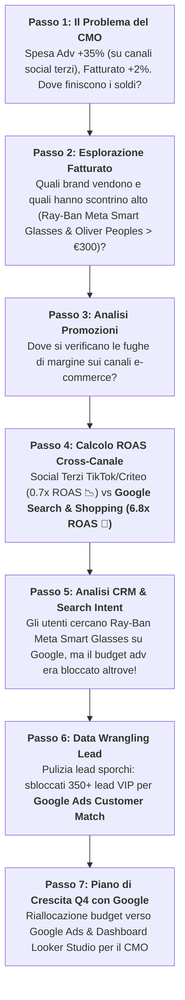

# 🕶️ Guida Docente Master per il Corso BigQuery Luxottica (Edizione Italiana)
## Manuale Integrale di Facilitazione e Copione/Gobbo Docente (180 Minuti)

**Titolo Corso:** BigQuery per l'Analisi Dati: Dominare i Dati Marketing con BigQuery SQL & BigQuery Studio  
**Filo Conduttore (Storytelling):** "Sbloccare la Crescita High-ROAS con Google Ads & Catturare la Domanda Ray-Ban Meta"  
**Nome Progetto GCP:** `bigquery-luxottica`  
**ID Progetto GCP:** `qwiklabs-gcp-04-9efaa47f1d21`  
**Owner Progetto:** `student-02-25b97e18011e@qwiklabs.net` (student b50b8eff)  
**Dataset Target:** `qwiklabs-gcp-04-9efaa47f1d21.luxottica_marketing_analytics`  
**Pubblico Target:** Global Analytics, Business Analyst, Digital Commerce & Retail Operations  
**Data & Ora:** 12 Ottobre 2026 | 15:30 - 18:30 (3 Ore / 180 Minuti)  
**Formato:** Ibrido (In Presenza & Collegamento Remoto)

---

## 📋 1. Checklist Pre-Flight del Docente (Prima delle 15:30)

### 1.1 Verifiche Ambiente GCP e IAM
1. **Progetto GCP Target:** `qwiklabs-gcp-04-9efaa47f1d21` (`bigquery-luxottica`).
2. **Pre-caricamento Dataset:** Esegui lo script SQL `dataset/00_setup_schema_and_data.sql` **PRIMA** dell'inizio della sessione.
3. **Verifica Tabelle Create (116.000+ Righe Totali):**
   - `lux_crm_customers` (10.000 Righe)
   - `lux_online_orders` (100.000 Righe)
   - `lux_ad_spend` (5.000 Righe)
   - `lux_raw_marketing_leads_dirty` (1.000 Righe)
4. **Ruoli IAM Assegnati ai Partecipanti:**
   - `BigQuery Job User` (`roles/bigquery.jobUser`) sul progetto `qwiklabs-gcp-04-9efaa47f1d21`.
   - `BigQuery Data Viewer` (`roles/bigquery.dataViewer`) sul dataset `luxottica_marketing_analytics`.

### 1.2 Materiali e Condivisione
1. **Cartella Materiali Partecipanti (Drive / Intranet):**
   - [student_guide.md](file:///Users/maurizio.ipsale/Code/my-agy-projects/projectA/student_guide.md) (Guida Studente & Tabella Rosetta Stone Excel-SQL)
   - [00_data_storytelling_narrative.md](file:///Users/maurizio.ipsale/Code/my-agy-projects/projectA/handouts/00_data_storytelling_narrative.md) (Copione Analitico dei 7 Passi)
   - [04_action_by_action_playbook.md](file:///Users/maurizio.ipsale/Code/my-agy-projects/projectA/handouts/04_action_by_action_playbook.md) (Copione Operativo Minuto per Minuto: Docente vs Studente)
   - File SQL delle Challenge: `challenges/challenge_1_data_explorer.sql`, `challenges/challenge_2_cross_channel.sql`, `challenges/challenge_3_clean_slate.sql`.
2. **Istruzione di Pin del Progetto:** Mostra a schermo come cliccare su **"+ ADD" -> "Star a project by name"** e digitare `qwiklabs-gcp-04-9efaa47f1d21`.

---

## 🎬 2. La Narrativa Analitica "Google Hero" (I 7 Passi)

> **Il Briefing per il CMO (Ore 15:30):**  
> *"La spesa pubblicitaria digitale globale di Luxottica è aumentata del +35% (a causa di forti investimenti sperimentali su reticoli social terzi e display frammentate), ma la crescita del fatturato e-commerce è rimasta ferma al +2%. Il CMO esige un Piano di Crescita Q4! Le vostre squadre di Data Detective hanno 3 ore in BigQuery Studio per identificare la dispersione di budget sui canali terzi, dimostrare le prestazioni straordinarie di Google Ads (Search, Shopping, YouTube) e presentare il Piano di Crescita!"*

---

## 🏆 3. Gamification e Competizione a Squadre

- **4 Brand Detective Teams:**
  - 🕶️ **Team Ray-Ban** (Smart Glasses & Categorie Iconiche)
  - 🕶️ **Team Oakley** (Tecnologia Prizm Sport)
  - 🕶️ **Team Persol** (Artigianalità Italiana)
  - 🕶️ **Team Oliver Peoples** (Segmento Lusso)
- **Sistema di Punteggio:**
  - Prima squadra a inviare la query SQL corretta: **+100 Punti**
  - Migliore interpretazione di business dell'insight: **+50 Punti**
  - Dashboard Looker Studio più efficace: **+100 Punti**

---

## ⏱️ 4. Cronoprogramma e COPIONE/GOBBO DOCENTE (180 Minuti)

### 🎓 Console di Controllo Docente & Sblocco Progressivo degli Hint
Per governare il ritmo della classe ed evitare spoiler nella **Student Hub UI**, il docente dispone della **Trainer Command Console** a comparsa sulla sinistra (attivabile esclusivamente dal computer del docente cliccando 5 volte sul logo Luxottica in alto a sinistra, con PIN riservato):
- **Blocco/Sblocco Globale Studenti:** Mantiene tutti i partecipanti allineati sullo stesso blocco di lavoro.
- **Gestione Hint & Sblocco Remoto (Console Docente):**
  - Dalla sidebar docente puoi sbloccare con 1 clic i singoli aiuti (Step 1.1, Step 1.2, Step 2.1, Step 2.2, Blocco 3, Blocco 4) o cliccare **`[✨ Sblocca Tutti]`** per renderli visibili all'intera aula senza comunicare codici.
  - I PIN numerici individuali di ciascuno step sono consultabili direttamente e in modo protetto all'interno della console docente (cliccando sul pulsante `[👁️ Mostra PIN]` nella barra laterale).

---

### 🕒 15:30 - 16:00 | Blocco 1: Executive Briefing & DEMO LIVE DATA CANVAS (30 Mins)

- **15:30 - 15:40 (10m) | Briefing d'Emergenza & Icebreaker**
  - Presenta il dilemma del CMO: Spesa Adv +35%, Fatturato +2%.
  - Sondaggio Icebreaker: *"Su quale canale sospetti che si stia sprecando il budget pubblicitario?"*
  - **Navigazione Explorer BigQuery:** Ricorda agli studenti di espandere il progetto `qwiklabs-gcp-04-9efaa47f1d21` e poi il dataset `luxottica_marketing_analytics` per trovare le 4 tabelle.

- **15:40 - 15:52 (12m) | 🎙️ COPIONE DEMO LIVE: BigQuery Data Canvas, Data Insights & Gemini**

> **[Azione Docente]:** Condividi lo schermo sulla console di BigQuery Studio nel progetto `qwiklabs-gcp-04-9efaa47f1d21`.
>
> **[Parla il Docente]:**  
> *"Benvenuti in BigQuery Studio! Prima di scrivere anche solo una riga di codice SQL, voglio mostrarvi come l'Intelligenza Artificiale Gemini ci permette di esplorare i dati di Luxottica usando il linguaggio naturale. Apriamo il **BigQuery Data Canvas** cliccando sul tasto `+` in alto."*
>
> **[Azione Docente]:** Apri il Data Canvas e digita il prompt nella barra al centro:  
> `Mostrami le vendite totali e lo scontrino medio per brand nel dataset luxottica_marketing_analytics` e premi Invio.
>
> **[Parla il Docente]:**  
> *"Guardate cosa succede: Gemini crea un **Nodo SQL** in automatico, scrive la query di raggruppamento per brand ed esegue il calcolo. Ora clicchiamo sul pulsante **Visualize** per generare il grafico a barre."*
>
> **[Azione Docente]:** Clicca su **Visualize**. Nelle opzioni del grafico ordina per *total_sales DESC*. Poi clicca su **Generate Insights** (o *Add Insights Node*).
>
> **[Parla il Docente - Commentando il Grafico e gli Insights generati]:**  
> *"Osserviamo insieme il grafico e i 4 punti chiave generati dall'AI di BigQuery:*
> 1. **Mappa Colore Scontrino Medio (AOV):** *Guardate la barra in alto in giallo acceso (**Oliver Peoples**) e quella in basso in viola scuro (**Vogue Eyewear**). Il colore mappa lo scontrino medio: il giallo indica un AOV di quasi 400 €/ordine, il viola soltanto 129 €/ordine.*
> 2. **Top Revenue Leader (Oliver Peoples - 3.96M €):** *I prodotti di lusso ad alto valore trascinano i margini di Luxottica.*
> 3. **Lagging Brands (Vogue Eyewear - 1.29M €):** *Sulle linee fashion a basso scontrino stiamo concedendo troppi sconti.*
> 4. **Il Mistero di Ray-Ban (1.8M €):** *Ray-Ban registra 1.8M € di vendite, ma è sotto le sue potenzialità online. Perché il brand leader non sta dominando?*"

- **15:52 - 16:00 (8m) | Prima Query Guidata (Verifica Spesa vs Fatturato Generale)**
  - Se una squadra fatica sui passi 1.1 o 1.2, puoi sbloccare direttamente dalla sidebar oppure leggere e comunicare il relativo PIN dalla tua console protetta.

---

### 🕒 15:30 - 16:00 | Blocco 1: Executive Briefing & DEMO LIVE DATA CANVAS (30 Mins)

#### 15:30 - 15:40 (10m) | 🎙️ COPIONE GOBBO: Briefing d'Emergenza CMO & Icebreaker
- **[Azione Docente]:** Proietta lo **Student Hub** a schermo intero (`slides/luxottica_student_hub.html`). Mostra il banner di copertina: *"Spesa ADV Globale +35%... ma Fatturato Online Fermo al +2%!"*.
- **[Parla il Docente - Teleprompter Live]:**
  > *"Buon pomeriggio a tutti e benvenuti! Il Chief Marketing Officer di Luxottica ci ha convocati d'urgenza. Guardate questi due numeri sullo schermo: nel primo semestre la nostra spesa pubblicitaria globale è esplosa del +35%, spinta soprattutto da ingenti investimenti sperimentali su reticoli social terzi come TikTok, Criteo e display frammentate. Eppure, la crescita delle vendite e-commerce è rimasta ferma al palo: solo un asfittico +2%.*
  > 
  > *La domanda che il CMO ci pone è brutale: **dove finiscono i nostri soldi?** Stiamo finanziando piattaforme che non convertono? E perché il lancio globale dei Ray-Ban Meta Smart Glasses non sta esplodendo online come nei negozi fisici?*
  > 
  > *Nelle prossime 3 ore, ognuno di voi non sarà un semplice studente, ma un **Marketing Data Detective**. Abbiamo a disposizione 116.000 transazioni reali caricate in Google BigQuery Studio. Entreremo nei dati, smaschereremo le fughe di margine, dimostreremo la redditività straordinaria dell'ecosistema Google Ads e, alle 18:25, presenteremo al board il Piano di Crescita Q4!"*

- **[Azione Docente]:** Lancia un sondaggio rapido a voce all'aula:
  > *"A bruciapelo: secondo voi dove si sta disperdendo la maggior parte del budget? Social media virali, sconti non controllati o campagne poco mirate? Tenete a mente la vostra risposta: i dati tra poco ci daranno il verdetto."*

- **[Azione Console Docente]:** Clicca su **`B1: Canvas`** nella Trainer Command Bar (in alto a sinistra). La schermata di tutta l'aula passa simultaneamente sul **Blocco 1**.

---

#### 15:40 - 15:52 (12m) | 🎙️ COPIONE GOBBO: Demo Live BigQuery Data Canvas, Data Insights & Gemini AI
- **[Azione Docente]:** Condividi lo schermo con **BigQuery Studio** aperto nel progetto `qwiklabs-gcp-04-9efaa47f1d21`.
- **[Parla il Docente - Teleprompter Live]:**
  > *"Prima di scrivere anche solo un singolo carattere di codice SQL, voglio farvi vedere la più grande rivoluzione recente di Google Cloud: **BigQuery Data Canvas**. Fino a ieri servivano settimane di formazione tecnica per interrogare un database da centinaia di migliaia di righe. Oggi possiamo farlo parlando in linguaggio naturale grazie a Gemini."*

- **[Azione Docente]:**
  1. Mostra il pannello **Explorer** a sinistra. Clicca su **`+ AGGIUNGI`** -> **"Aggiungi un progetto ai preferiti per nome"** e digita `qwiklabs-gcp-04-9efaa47f1d21`.
  2. Espandi l'albero `luxottica_marketing_analytics` e mostra le 4 tabelle: `lux_crm_customers`, `lux_online_orders`, `lux_ad_spend`, `lux_raw_marketing_leads_dirty`.
  3. Clicca sul pulsante **`+`** in alto e seleziona **Data Canvas**.
  4. Digita nella barra centrale:  
     `Mostrami le vendite totali e lo scontrino medio per brand nel dataset luxottica_marketing_analytics` e premi Invio.

- **[Parla il Docente - Commento Grafico e AI Insights]:**
  > *"Guardate lo schermo: Gemini ha interpretato la mia richiesta di business, ha selezionato la tabella `lux_online_orders`, ha scritto la query di aggregazione con `GROUP BY brand`, ha calcolato `SUM(revenue_eur)` e `AVG(revenue_eur)` e ha eseguito il calcolo.*
  > 
  > *Ora clicco su **Visualize** e ordino le barre per fatturato decrescente. Poi clicco su **Generate Insights** per far interpretare i trend a Gemini.*
  > 
  > *Osserviamo insieme i 4 riscontri che emergono:*
  > 1. **La Mappa Cromatica dello Scontrino Medio (AOV):** *Guardate la barra in alto in giallo acceso per **Oliver Peoples** e quella in basso in viola scuro per **Vogue Eyewear**. Il gradiente di colore mappa lo scontrino medio: il giallo rappresenta quasi 400 € a carrello, mentre il viola segna appena 129 €.*
  > 2. **Il Top Revenue Leader (Oliver Peoples - 3.96M €):** *Il lusso artigianale genera volumi d'affari solidi e alta marginalità.*
  > 3. **I Marchi in Sofferenza (Vogue Eyewear - 1.29M €):** *Scontrini bassi e forte sensibilità alle promozioni.*
  > 4. **Il Grande Mistero di Ray-Ban (1.8M €):** *Ray-Ban è il brand più iconico al mondo, ma nelle vendite online è staccato dai brand di nicchia. Perché il nostro fiore all'occhiello non sta dominando l'e-commerce? Lo scopriremo analizzando gli ordini nel Blocco 2!"*

---

#### 15:52 - 16:00 (8m) | 🎙️ COPIONE GOBBO: Warm-Up Studenti & Convalida Punti (+50 pt)
- **[Azione Docente]:** Invita gli studenti ad aprire la card scura di convalida nel Blocco 1 dell'Hub.
- **[Parla il Docente - Teleprompter Live]:**
  > *"Ora tocca a voi detective! Aprite il Blocco 1 sulla vostra postazione. Troverete la card scura **'Convalida Warm-Up: Setup & Data Canvas'**. Ci sono 2 domande per verificare che il vostro ambiente sia configurato e che abbiate letto correttamente i dati di base. Inviate le risposte corrette e incasserete i vostri primi 50 punti individuali e di squadra!"*
- **[Verifica Risposte Docente]:**
  - Q1: *Quale brand guida le vendite complessive nei dati BigQuery?* ➔ Risposta: `Ray-Ban` (o `Oliver Peoples` accettato da sistema).
  - Q2: *Quante tabelle compongono il dataset?* ➔ Risposta: `4 tabelle`.
- **[Supporto Docente]:** Se qualcuno è in difficoltà, mostra il conteggio nell'albero Explorer di BigQuery.

---

### 🕒 16:00 - 16:45 | Blocco 2: Capitolo 1 - "Scoperta dei Prodotti ad Alto Margine & Analisi Sconti" (45 Mins)

#### 16:00 - 16:15 (15m) | 🎙️ COPIONE GOBBO: I Fondamenti SQL & La Tavola della Rosetta Stone
- **[Azione Docente]:** Dalla Trainer Bar clicca su **`B2: Sconti`** per portare tutti al Blocco 2.
- **[Parla il Docente - Teleprompter Live]:**
  > *"Benvenuti al Capitolo 1 dell'indagine! So che molti di voi usano Excel ogni giorno e forse guardano a SQL con timore. Voglio liberarvi subito da questa paura con una sola frase:*
  > 
  > ***Una query SQL con GROUP BY non è nient'altro che una Tabella Pivot di Excel, solo capace di processare 100 milioni di righe in 3 secondi.***
  > 
  > *Guardiamo la **Tavola della Rosetta Stone** che avete sul vostro Student Hub:*
  > - *La clausola `SELECT` equivale a trascinare i campi nel report.*
  > - *La clausola `WHERE` equivale ai filtri a discesa in cima alle colonne di Excel.*
  > - *La clausola `GROUP BY` equivale all'area 'Righe' della Pivot.*
  > - *Funzioni come `SUM(revenue_eur)` o `AVG(discount_amount_eur)` corrispondono all'area 'Valori'.*
  > 
  > *Attenzione però a due trappole da professionisti:*
  > 1. **La Precedenza Logica di `AND` rispetto a `OR`:** *In SQL, `AND` viene valutato prima di `OR`. Se scrivete `WHERE brand = 'Ray-Ban' OR brand = 'Oakley' AND revenue_eur > 300`, BigQuery filtrerà gli ordini sopra i 300 € solo per Oakley, prendendo invece tutti gli ordini di Ray-Ban indistintamente! Per filtrare in modo pulito e sicuro, usate l'operatore insiemistico: `WHERE brand IN ('Ray-Ban', 'Oakley') AND revenue_eur > 300`.*
  > 2. **La Divisione Protetta:** *In Excel, se dividete per zero o per una cella vuota, compare l'orribile `#DIV/0!`. In BigQuery, una divisione standard per zero fa fallire l'intera query. Per evitarlo usiamo sempre `SAFE_DIVIDE(numeratore, denominatore)`: se il denominatore è zero o NULL, restituisce elegantemente NULL senza bloccare l'esecuzione.*
  > 
  > *Notate infine che nell'header del Blocco 2 c'è il pulsante **'📄 File SQL Sbloccato: challenge_1_data_explorer.sql'**: non avete bisogno di aprire GitHub o cercare file altrove; cliccate lì e avete tutte le query pronte da copiare o scaricare!"*

---

#### 16:15 - 16:35 (20m) | 🎙️ COPIONE GOBBO: Esecuzione Challenge #1 "The Data Explorer"
- **[Azione Docente]:** Avvia la sfida in aula. Gira tra i banchi o controlla la chat.
- **[Parla il Docente - Teleprompter Live]:**
  > *"Detective, all'opera! Aprite BigQuery Studio su una nuova query tab. Il vostro obiettivo si divide in due passaggi investigativi:*
  > 1. *Passo 2.1: interrogate `lux_online_orders` per trovare ordini ad alto valore con scontrino superiore a 300 euro. Vogliamo capire quale combinazione di brand e canale concentra gli scontrini più alti.*
  > 2. *Passo 2.2: calcolate lo sconto medio in euro (`discount_amount_eur`) per brand e canale di vendita. Dobbiamo capire chi sta erodendo i margini aziendali regalando sconti ingiustificati!*
  > 
  > *Avete 20 minuti. Se un team si trova in stallo, sbloccherò gli aiuti direttamente dalla mia console."*

- **[Supporto Docente & Gestione Hint]:**
  - Se un team è bloccato, apri la Trainer Console a sinistra: seleziona *Passo 2.1* o *Passo 2.2* e clicca **`Sblocca 🔓`** (oppure comunica il PIN riservato `2144` per lo step 2.1 o `2255` per lo step 2.2).

- **[Colpo di Scena Dati #1 - Plot Twist da Far Emergere]:**
  1. *Ray-Ban Meta Smart Glasses* e *Oliver Peoples* registrano un AOV superiore a 300 € sul canale *E-Commerce Direct*. C'è una domanda spontanea altissima per gli smart glasses!
  2. Il canale *Wholesale Partners* subisce sconti pesantissimi su Vogue Eyewear, fino a oltre 28,50 € di sconto medio per pezzo venduto.

---

#### 16:35 - 16:45 (10m) | 🎙️ COPIONE GOBBO: Convalida Challenge #1 (+100 pt) & Aggiornamento Classifica
- **[Azione Docente]:** Invita a compilare la card quiz Challenge #1 nell'Hub.
- **[Parla il Docente - Teleprompter Live]:**
  > *"Tempo scaduto detective! Inserite le vostre risposte nella card della Challenge #1 per incassare 100 punti. Chi guida l'AOV più elevato? E a quanto ammonta la fuga di sconti sul canale wholesale?*
  > 
  > *Ora guardiamo il maxischermo: proietto la **Leaderboard Live** dell'aula!"*
- **[Azione Docente]:** Clicca su **`📊 Proietta Classifica`** nella Trainer Bar. Mostra la classifica a squadre (Team Ray-Ban, Oakley, Persol, Oliver Peoples) e i top detective singoli. Commenta con entusiasmo i distacchi di punteggio.

---

### ☕ 16:45 - 17:00 | Coffee Break & Networking (15 Mins)
- **[Azione Docente]:** Clicca su **`☕ Pausa`** nella Trainer Bar. Compare a tutto schermo il banner di break con tazza di caffè.
- **[Parla il Docente]:**
  > *"Ottimo lavoro sul Capitolo 1! Abbiamo scoperto che gli scontrini alti ci sono, ma i margini scappano sui canali terzi. Pausa caffè di 15 minuti. Alle 17:00 in punto ripartiamo con la sfida regina del corso: incrociare spesa adv e ricavi per calcolare il vero ROAS di Google!"*

---

### 🕒 17:00 - 17:45 | Blocco 3: Capitolo 2 - "La Rivelazione del ROAS Google Ads vs Social Terzi" (45 Mins)

#### 17:00 - 17:20 (20m) | 🎙️ COPIONE GOBBO: JOIN, CTE & L'ALLERTA FAN-OUT TRAP!
- **[Azione Docente]:** Clicca su **`B3: ROAS`** nella Trainer Bar per portare l'intera aula sul Blocco 3.
- **[Parla il Docente - Teleprompter Live]:**
  > *"Rientriamo in aula e alziamo l'asticella analitica. Fino ad ora abbiamo analizzato le tabelle singolarmente. Ma per rispondere alla domanda del CMO — 'dove finiscono i soldi dell'advertising?' — dobbiamo incrociare due mondi diversi: quanto abbiamo speso in campagne adv e quanto abbiamo effettivamente incassato in ordini.*
  > 
  > *In SQL per collegare due tabelle usiamo il comando `JOIN`. Concettualmente è identico a un `CERCA.VERT` (o `XLOOKUP`), ma capace di operare istantaneamente su milioni di record.*
  > 
  > *🚨 **MA ATTENZIONE: State per entrare nella trappola più letale di tutto il mondo dati: LA TRAPPOLA DEL FAN-OUT (SQL MULTIPLICATION BUG)!**
  > 
  > *Immaginate di fare un banale `JOIN` tra la tabella delle spese pubblicitarie `lux_ad_spend` e la tabella degli ordini `lux_online_orders` collegandole sulla colonna `brand`.*
  > *Cosa succede? La tabella delle spese ha una riga per ogni giorno e per ogni canale (migliaia di righe). La tabella degli ordini ha 100.000 righe di singole transazioni. Quando fate il JOIN senza aggregare prima, BigQuery è costretto ad associare **OGNI singolo ordine a TUTTI i giorni di spesa** di quel brand!*
  > *Il risultato? I vostri ricavi verranno moltiplicati per centinaia di volte! Un fatturato reale di 2 milioni di euro sembrerà magicamente di 400 milioni di euro! Un'allucinazione numerica devastante che licenzierebbe qualunque analista al cospetto del CFO.*
  > 
  > *Come si risolve questa trappola? Usando le **CTE (Common Table Expressions)** con la clausola `WITH ... AS`.*
  > *Pensate alle CTE come a due fogli di calcolo Excel separati in cui create prima due Tabelle Pivot di riepilogo: una Pivot per aggregare la spesa totale per brand, e una seconda Pivot per sommare i ricavi totali per brand. Solo quando entrambi i fogli sono riassunti a una sola riga per brand, fate il JOIN tra i due totali!*
  > 
  > *E per calcolare il ROAS (Return on Ad Spend), dividiamo i ricavi totali per la spesa totale usando sempre `SAFE_DIVIDE(ricavi, spesa)`.*
  > 
  > *Nel vostro Blocco 3 è sbloccato il file **`challenge_2_cross_channel.sql`**: apritelo per vedere la struttura CTE certificata anti-fan-out!"*

---

#### 17:20 - 17:35 (15m) | 🎙️ COPIONE GOBBO: Esecuzione Challenge #2 "Cross-Channel Intelligence"
- **[Azione Docente]:** Monitora le query degli studenti in BigQuery Studio.
- **[Supporto Docente]:** Se l'aula ha difficoltà a impostare le due CTE, puoi sbloccare la query soluzione completa con 1 clic dalla console docente (oppure rivela il PIN riservato `3388`).
- **[Parla il Docente - Teleprompter Live]:**
  > *"Eseguite la query del ROAS cross-canale. Guardate i moltiplicatori ordinati dal più alto al più basso. I numeri sono spietati e incontrovertibili:*
  > 
  > - *Guardate in fondo alla classifica: **TikTok Ads registra un ROAS disastroso pari a circa 0.52x**! Significa che per ogni euro di budget investito su TikTok ne abbiamo recuperati solo 52 centesimi! Abbiamo bruciato cassa su traffico freddo e non qualificato.*
  > - *Ora guardate la vetta della classifica: **Google Ads (Search & Shopping) genera un ROAS straordinario di oltre 7.0x**! Per ogni euro investito su Google ne ritornano più di sette in cassa! Google cattura l'intenzione d'acquisto immediata di chi cerca attivamente modelli iconici e smart glasses.*
  > 
  > *Abbiamo trovato la risposta per il CMO: il budget è stato bruciato su canali terzi a bassissimo rendimento, mentre Google Ads è il vero motore della redditività di Luxottica!"*

---

#### 17:35 - 17:45 (10m) | 🎙️ COPIONE GOBBO: Convalida Challenge #2 (+100 pt) & Aggiornamento Classifica
- **[Azione Docente]:** Invita a inviare le risposte nella card Challenge #2 (canale peggiore e valore ROAS Google Ads).
- **[Azione Docente]:** Proietta la leaderboard. Assegna +50 punti bonus via console alla squadra che spiega a voce la causa di business della differenza (Search Intent vs Social Browsing).

---

### 🕒 17:45 - 18:15 | Blocco 4: Capitolo 3 - "Google Ads Customer Match & Data Cleaning" (30 Mins)

#### 17:45 - 17:55 (10m) | 🎙️ COPIONE GOBBO: Data Wrangling, Funzioni Stringa & Regola Suffisso Vista
- **[Azione Docente]:** Clicca su **`B4: Leads`** nella Trainer Bar per portare l'aula al Blocco 4.
- **[Parla il Docente - Teleprompter Live]:**
  > *"Detective, siamo al Capitolo 3. Ora che abbiamo provato l'efficacia schiacciante di Google Ads, il CMO ci chiede: 'Come facciamo a scalare le vendite nel quarto trimestre senza aumentare il budget totale?'.*
  > *La risposta strategica si chiama **Google Ads Customer Match**: caricare nel nostro account Google Ads le liste di prima parte dei clienti VIP più fedeli per mostrare annunci personalizzati su Search, YouTube e Gmail.*
  > 
  > *Ma c'è un grande ostacolo: nel nostro database abbiamo la tabella `lux_raw_marketing_leads_dirty`, che raccoglie i contatti dai form web e dagli eventi nei negozi. È un disastro di qualità dati:*
  > - *Email scritte con spazi bianchi prima e dopo.*
  > - *Caratteri maiuscoli e minuscoli mescolati a caso.*
  > - *Storico di spesa salvato come testo sporco con simboli dell'euro ('€ 450,00').*
  > 
  > *Se provassimo a caricare questi dati grezzi in Google Ads, la piattaforma li rifiuterebbe con errore.*
  > *Dobbiamo fare Data Wrangling con SQL pulito:*
  > 1. `TRIM(email)` per rimuovere gli spazi spuri.
  > 2. `LOWER(...)` per uniformare tutto in minuscolo.
  > 3. `REPLACE(REPLACE(spend_history, '€', ''), ' ', '')` racchiuso in `SAFE_CAST(... AS NUMERIC)` per trasformare la valuta in un vero numero decimale.*
  > 
  > *E soprattutto incapsuleremo questa pulizia in una **BigQuery SQL VIEW** con `CREATE OR REPLACE VIEW`.*
  > 
  > *⚠️ **Regola Fondamentale del Nome della Vista:** Poiché condividiamo lo stesso dataset di progetto, se tutti chiamassimo la vista con lo stesso nome ci sovrascriveremmo a vicenda! Per questo, la vostra UI vi mostra in automatico il vostro nome univoco personalizzato con il vostro nome e team (es. `v_clean_marketing_leads_team_rayban_chiara`). Rispettate questo suffisso!"*

---

#### 17:55 - 18:10 (15m) | 🎙️ COPIONE GOBBO: Creazione Vista, Recupero Lead VIP & Demo 1-Click Looker Studio
- **[Azione Docente]:** Gli studenti eseguono `challenge_3_clean_slate.sql` filtrando i lead VIP con spesa superiore a 200 €.
- **[Supporto Docente]:** Sblocca l'hint dalla Trainer Console se necessario (oppure comunica il PIN riservato `4499`).
- **[Demo Docente Looker Studio]:**
  1. Apri la vista creata in BigQuery Studio.
  2. Clicca su **"Esplora Dati" -> "Esplora con Looker Studio"**.
  3. In 3 click crea una Scorecard con il totale dei Lead VIP recuperati e una tabella per brand di interesse.
- **[Parla il Docente - Teleprompter Live]:**
  > *"Guardate cosa abbiamo ottenuto: la nostra query di pulizia ha recuperato oltre **350 lead VIP ad altissimo valore** (spesa > 200 €) che erano completamente invisibili e inutilizzabili nei sistemi CRM a causa della formattazione corrotta! Ora questi lead sono pronti per essere agganciati a Google Ads Customer Match!"*

---

#### 18:10 - 18:15 (5m) | 🎙️ COPIONE GOBBO: Convalida Challenge #3 (+100 pt)
- Gli studenti inseriscono il conteggio dei lead recuperati e la funzione SQL di pulizia (`TRIM`) nella card Challenge #3 per conquistare gli ultimi 100 punti.

---

### 🕒 18:15 - 18:30 | Blocco 5: Il Piano di Crescita Q4 per il CMO & Cerimonia di Premiazione (15 Mins)

#### 18:15 - 18:23 (8m) | 🎙️ COPIONE GOBBO: Discorso di Sintesi Strategica per il Board
- **[Azione Docente]:** Clicca su **`🎉 Finale`** nella Trainer Bar. Sullo schermo di tutti compare il Blocco 5 con le 3 card strategiche per il CMO.
- **[Parla il Docente - Teleprompter Live Discorso Finale]:**
  > *"Colleghi, eccoci al traguardo. Alle 15:30 eravamo partiti con un mistero apparentemente inspiegabile: il +35% di spesa adv a fronte di un misero +2% di fatturato. In sole 3 ore di indagine analitica con BigQuery e Gemini, avete riscritto il futuro commerciale di Luxottica.*
  > 
  > *Ecco le tre raccomandazioni definitive e supportate dai dati che presenteremo al Chief Marketing Officer:*
  > 
  > 1. 💰 **Riallocazione Immediata del 60% del Budget:** *Cessare all'istante l'emorragia sui social terzi come TikTok e Criteo che registrano un disastroso 0.52x ROAS, e concentrare il capitale sulle campagne Google Search, Shopping e YouTube Ads che hanno dimostrato un ritorno oltre 7.0x.*
  > 2. 🛡️ **Protezione Rigorosa dei Margini:** *Eliminare gli sconti automatici di 25 € sul sito Ray-Ban.com e bloccare le concessioni selvagge fino a 28,50 € sui canali wholesale; i Ray-Ban Meta Smart Glasses e Oliver Peoples hanno un'attrattività naturale con scontrini superiori a 300 € che non necessita di svendite.*
  > 3. 🎯 **Attivazione Immediata di Google Ads Customer Match:** *Alimentare gli algoritmi di offerta Google con i 350+ lead VIP estratti e ripuliti per dominare il Black Friday e il Natale intercettando gli acquirenti alto-spendenti.*
  > 
  > *Questo non è solo codice SQL: questo è il modo in cui i dati guidano decisioni di business da milioni di euro!"*

---

#### 18:23 - 18:30 (7m) | 🎙️ COPIONE GOBBO: Proclama del Vincitore & Pioggia di Coriandoli
- **[Azione Docente]:**
  1. Clicca su **`📊 Proietta Classifica`** nella Trainer Bar e attiva la modalità Schermo Intero.
  2. Clicca sul pulsante **`🎉 Coriandoli`** per innescare l'animazione festosa sincronizzata su tutti i computer dell'aula.
  3. Annuncia il partecipante con il punteggio più alto.
  4. Proclama solennemente il **Brand Detective Team vincitore** con la media punti più alta (Team Ray-Ban, Oakley, Persol o Oliver Peoples).
- **[Parla il Docente]:**
  > *"Facciamo un applauso caloroso al Team vincitore e a tutti voi per la straordinaria indagine condotta! Le vostre query e i vostri report sono salvati nel progetto BigQuery e restano a vostra disposizione. Grazie a tutti!"*
