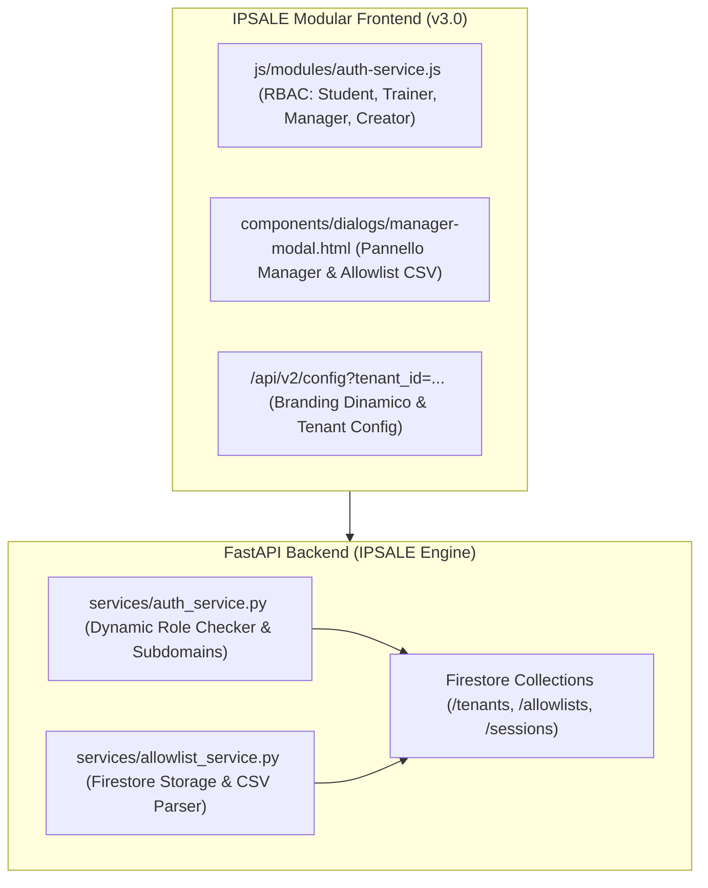

# Technical Implementation Plan: IPSALE Engine v3.0 (White-Label & Manager Portal)

**File di Riferimento Spec:** `SPEC-universal-training-platform.md` & `CAPABILITY-MAP.md`  
**Piattaforma:** IPSALE Engine (**I**nteractive **P**latform for **S**kill **A**ssessment & **L**ive **E**ducation)  
**Obiettivo:** Disaccoppiare la piattaforma da Luxottica (trasformandolo in un Tenant POC) ed estendere l'autenticazione con il ruolo `MANAGER` per la gestione dinamica dell'allowlist e l'importazione CSV.

---

## 1. Architettura dei Componenti Target (v3.0)

---

## 2. Fasi di Implementazione Sequenziali

### Fase 1: White-Label Branding Engine (`white-label-branding`)
- Estrarre dal backend e dal frontend tutti i riferimenti cablati a Luxottica in configurazioni dinamiche `TenantConfig`:
  - `tenant_id` (default: `luxottica`)
  - `org_name` (default: `Luxottica Masterclass`)
  - `logo_url`
  - `team_names` (default: `['Ray-Ban', 'Oakley', 'Persol', 'Oliver Peoples', 'Vogue Eyewear']`)
- Aggiornare `/api/v2/config` per restituire il `TenantConfig` esteso.
- Aggiornare `i18n-translations.js` e `student-onboarding-modal.html` per renderizzare dinamicamente le opzioni dei team.

### Fase 2: Ruolo Manager & Pannello Gestione Allowlist (`manager-portal`)
- **Backend (`auth_service.py` & `main.py`)**:
  - Aggiungere il controllo del ruolo `MANAGER` per gli indirizzi email definiti in `MANAGER_EMAILS` (default: `maurizio.ipsale@gmail.com,manager@ipsale.io`).
  - Creare l'endpoint `GET /api/v3/admin/allowlist` per consultare l'allowlist corrente.
  - Creare l'endpoint `POST /api/v3/admin/allowlist` per aggiungere/rimuovere domini o email singole.
  - Creare l'endpoint `POST /api/v3/admin/allowlist/import-csv` per caricare elenchi massivi di partecipanti da file CSV/Excel.
- **Frontend (`manager-modal.html` & `manager-controls.js`)**:
  - Creare il modale nativo `<dialog id="manager-admin-modal">`.
  - Tabella di gestione dell'Allowlist con filtri e ricerca istantanea.
  - Area drag & drop per l'importazione di file CSV di partecipanti.
  - Pulsante per esportare i punteggi ed il report delle presenze dell'aula.

### Fase 3: Verification & Rebuild Pipeline
- Ricompilare il bundle frontend con `tools/build_frontend.py` ed eseguire `verify_frontend_bundle.py`.
- Eseguire unit test e verification script per testare i nuovi endpoint `/api/v3/admin/allowlist`.
- Commit e push su `main` per la distribuzione automatica su Cloud Run.

---

## 3. Matrice Rischi & Contromisure

| Rischio Identificato | Probabilità | Impatto | Contromisura Architetturale |
| :--- | :--- | :--- | :--- |
| **CSV Malformato caricato dal Manager** | Media | Medio | Parser CSV robusto con sanitizzazione regex ed `.strip().lower()` automatica. |
| **Bypass del ruolo Manager** | Bassa | Alto | Verifica rigida del JWT Google OAuth + email check sia lato client che lato server (`MANAGER_EMAILS`). |
| **Compatibilità Tenant Luxottica POC** | Bassa | Alto | Mantenere `luxottica` come tenant predefinito di fallback per garantire retro-compatibilità al 100%. |
