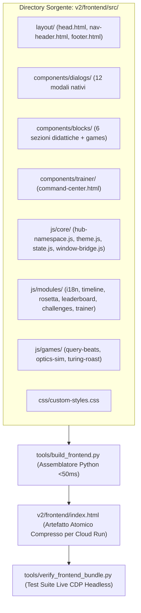

# Technical Implementation Plan: Frontend Modularization & Zero-Build Pipeline
**File di Riferimento Spec:** `SPEC-frontend-modularization.md` & `CAPABILITY-MAP.md`  
**Branch di Lavoro:** `feature/frontend-modularization`  
**Governance di Verifica:** Framework `/adversarial-debate` a 360° (UI/UX, QA Bug Hunter, Performance, Security, Lead Architect)

---

## 1. Architettura Target & Componenti

---

## 2. Fasi di Implementazione Sequenziali

### Fase 1: `builder-pipeline` (L'Assemblatore Deterministico)
- Implementare `tools/build_frontend.py` in puro Python (zero dipendenze pip o npm).
- Legge i partials tramite marker dichiarativi o struttura a directory e genera `v2/frontend/index.html`.
- Implementare `tools/verify_frontend_bundle.py` per confrontare hash, struttura DOM ed integrità dei tag.
- **Checkpoint di Validazione:** Eseguendo il build sui sorgenti estratti, il rendering deve essere funzionalmente indistinguibile dall'originale.

### Fase 2: `core-bridge` (Namespace `window.Hub` & Preservazione Handlers)
- Creare `v2/frontend/src/js/core/hub-namespace.js` e `window-bridge.js`.
- Mappare esplicitamente tutti i 165 metodi globali per garantire che i 180+ attributi inline `onclick`/`oninput` continuino a funzionare senza `ReferenceError`.
- Spostare `theme.js` con il resolver zero-FOUC collocato rigorosamente nell'<head>.

### Fase 3: `partials-dialogs` (Estrazione dei 12 Modali `<dialog>`)
- Scomporre i 12 modali in `v2/frontend/src/components/dialogs/`:
  1. `rosetta-modal.html` & `rosetta.js` (Filtro live bilingue)
  2. `leaderboard-modal.html` & `leaderboard.js` (Podio team animato e coriandoli)
  3. `role-selection.html`, `student-onboarding.html`, `trainer-pin.html`, `student-resume.html`
  4. `student-manager.html`, `trainer-solutions.html`, `playbook-modal.html`, `guide-modal.html`, `challenge-detail.html`
- Preservare gli stili nativi del top-layer e i backdrop blur.

### Fase 4: `partials-blocks` (Sezioni Didattiche & Motori Audio/Canvas)
- Scomporre in `v2/frontend/src/components/blocks/`:
  - `block-cover.html`, `block-1.html`, `block-2.html`, `block-break.html`, `block-3.html`, `block-4.html`, `block-5.html`.
- Estrarre i motori procedurali in `v2/frontend/src/js/games/`:
  - `query-beats.js` (Web Audio 808 Synth)
  - `optics-sim.js` (Ray-Ban Meta Canvas Simulator)
  - `turing-roast.js` (Prompt Roaster)
- Estrarre `i18n-translations.js` (~750 righe di dizionario IT/EN).

### Fase 5: `verification-suite` & Audit Avversariale a 360°
- Lanciare i subagenti del Consiglio Avversariale per testare il bundle generato:
  - 🎨 **UI/UX & Engagement Specialist**: Controllo layout, gerarchia visiva, animazioni view-transitions e contrasto.
  - 🐞 **QA & Edge Case Hunter**: Test di tutti i bottoni, apertura dialog, ricerca Rosetta Stone, submit quiz.
  - ⚡ **Performance Specialist**: Benchmark tempo di caricamento, metriche Vitals e dimensione bundle.
  - 🛡️ **Security Auditor**: Verifica CSP, isolamento scope, assenza di eval o injection.
- Esecuzione finale del deployment Cloud Run di test sul progetto Qwiklabs.

---

## 3. Matrice Rischi & Contromisure

| Rischio Identificato | Probabilità | Impatto | Contromisura Architetturale |
| :--- | :--- | :--- | :--- |
| **`ReferenceError` su bottoni inline** | Alta | Catastrofico | `window-bridge.js` con esportazione automatica censita di tutte le 165 funzioni su `window`. |
| **Purge accidentale di classi Tailwind** | Media | Alto | Mantenere il compilatore runtime `tailwindcss.min.js`, non usare Tailwind CLI statica. |
| **FOUC tema Dark/Light** | Bassa | Medio | `theme.js` iniettato all'inizio di `<head>` prima del rendering di `<body>`. |
| **Latenza di caricamento / Waterfall HTTP** | Bassa | Alto | Build monolitica atomica per Cloud Run: 1 singola richiesta HTTP per l'intera app. |
