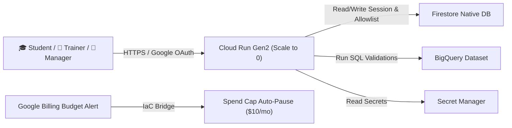

# 🏗️ IPSALE Engine v3.0 — Terraform Infrastructure-as-Code

This directory contains the production-ready, modular **Terraform (IaC)** configuration for deploying **IPSALE Engine v3.0** to Google Cloud Platform (GCP).

---

## 🏛️ Architecture Overview



---

## 📁 Directory Structure

- `versions.tf`: Required providers (`google`, `google-beta` >= 6.0) and Terraform version (>= 1.5.0).
- `variables.tf`: Input variables (Project ID, OAuth Client ID, allowed domains, role email lists).
- `main.tf`: Provider setup and enabling GCP APIs.
- `iam.tf`: Dedicated Service Account (`ipsale-runner`) with least-privilege IAM bindings.
- `artifact_registry.tf`: Docker repository (`ipsale-containers`).
- `firestore.tf`: Native Firestore database provisioning.
- `cloud_run.tf`: Cloud Run Gen2 serverless container deployment (`min_instances = 0`).
- `budget.tf` & `scripts/manage_spend_cap.sh`: FinOps $10/mo budget alert and Native Spend Cap auto-pause.
- `outputs.tf`: Cloud Run Service URL, repository paths, and post-deploy steps.
- `deploy.sh`: Automated build & deploy script.
- `MIGRATION_GUIDE.md`: Step-by-step GCP project migration guide.

---

## 🚀 Quick Deployment

1. Initialize `terraform.tfvars`:
   ```bash
   cp terraform.tfvars.example terraform.tfvars
   ```
2. Edit `terraform.tfvars` with your `project_id` and `google_client_id`.
3. Run deploy script:
   ```bash
   ./deploy.sh
   ```
