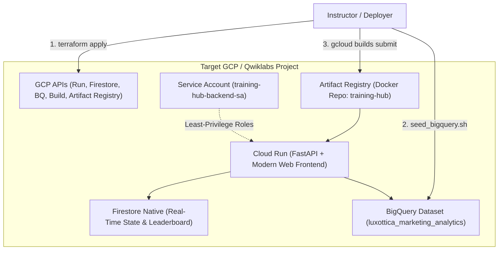

# Luxottica Training Hub — Infrastructure as Code (Terraform)

This Terraform module automates the entire lifecycle of the **Luxottica Training Hub (v2)** serverless infrastructure on Google Cloud Platform / Qwiklabs.

---

## Architecture Overview



---

## Managed Resources

1. **APIs (`main.tf`)**:
   - `run.googleapis.com`
   - `firestore.googleapis.com`
   - `cloudbuild.googleapis.com`
   - `bigquery.googleapis.com`
   - `artifactregistry.googleapis.com`
   - `iam.googleapis.com`
2. **Database (`firestore.tf`)**:
   - Native mode Firestore database `(default)` in multi-region `nam5`.
3. **Container Registry (`artifact_registry.tf`)**:
   - Artifact Registry Docker repository `training-hub`.
4. **Data Analytics (`bigquery.tf`)**:
   - BigQuery dataset `luxottica_marketing_analytics`.
5. **IAM Security (`iam.tf`)**:
   - Dedicated runtime Service Account: `training-hub-backend-sa`.
   - Minimal permissions:
     - `roles/datastore.user` (Firestore read/write)
     - `roles/bigquery.dataViewer` (Read training tables)
     - `roles/bigquery.jobUser` (Execute query validations)
   - Cloud Build Service Account permissions to deploy Cloud Run.

---

## 1-Click Redeployment to Any New Project

To spin up the entire hub on a brand new Qwiklabs project:

```bash
# 1. Authenticate and configure the new project
gcloud auth login
gcloud config set project <NEW_QWIKLABS_PROJECT_ID>

# 2. Run the turnkey bootstrap script
./v2/infra/terraform/deploy.sh
```

Or specify the target project explicitly:

```bash
./v2/infra/terraform/deploy.sh <NEW_QWIKLABS_PROJECT_ID> us-central1
```

The script will automatically:
1. Initialize & apply Terraform infrastructure.
2. Seed the 4 BigQuery tables (116,000+ realistic records).
3. Build the Docker container with Cloud Build.
4. Deploy the Cloud Run service with scale-to-zero.
5. Print the live URLs for students and the trainer console.

---

## Manual Terraform Commands

If you prefer to run Terraform manually:

```bash
cd v2/infra/terraform

# Initialize
terraform init

# Plan
terraform plan -var="project_id=<YOUR_PROJECT_ID>"

# Apply
terraform apply -var="project_id=<YOUR_PROJECT_ID>"
```
